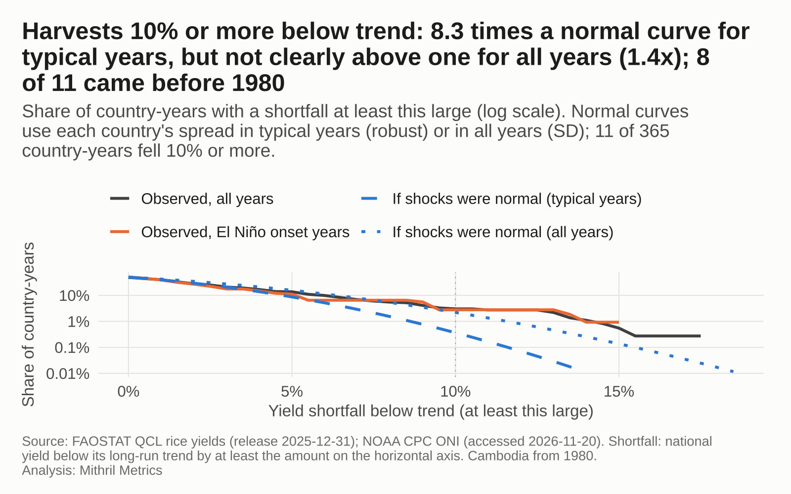
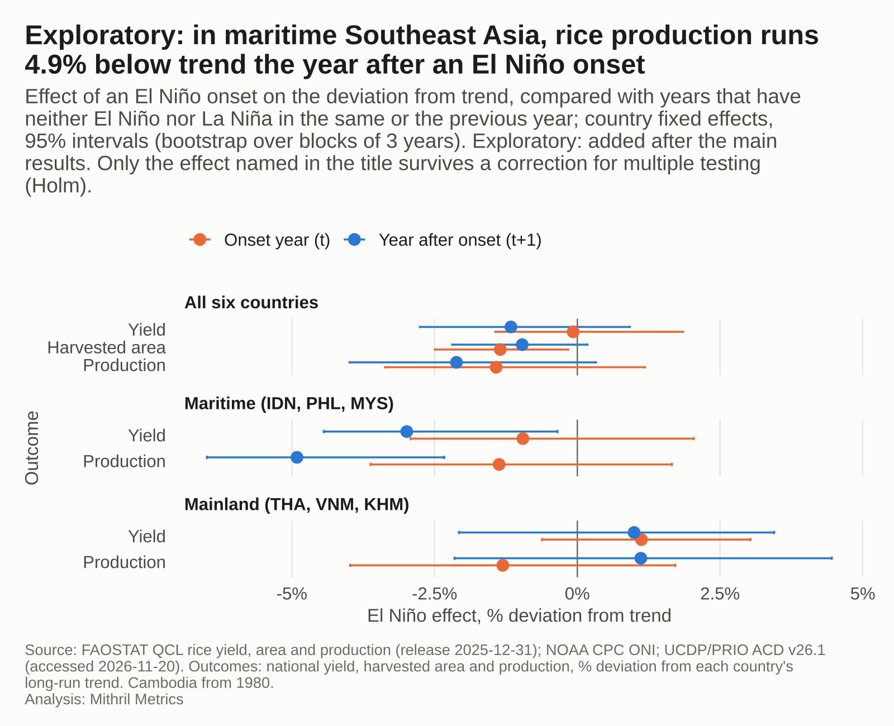

```{r}
#| label: guard
#| include: false
if (!file.exists("output/key_numbers.csv")) knitr::knit_exit("*Results pending.*")
```

```{r}
#| label: setup
#| include: false
suppressPackageStartupMessages({
  library(acutils)
  library(yaml)
})
meta    <- yaml::read_yaml("00_meta.yml", fileEncoding = "UTF-8")
kn_file <- "output/key_numbers.csv"
k <- function(key, ...) acutils::kn(key, file = kn_file, ...)
`%||%` <- function(a, b) if (is.null(a) || identical(a, "")) b else a
bullets  <- function(x) cat(paste0("- ", x), sep = "\n")
blog_url <- meta$links$blog %||% "[blog link]"
code_url <- meta$links$code %||% "[GitHub link]"
cpc_url  <- meta$hook$primary_source$url
appeal_url <- "https://www.wfp.org/publications/el-nino-fao-wfp-joint-anticipatory-action-appeal-june-2026-march-2027"
```

```{r}
#| label: shared-text
#| include: false
question <- meta$question

bottom_line <- paste0(
  "Not in the year it begins. Across six Southeast Asian countries since ", k("year_start"),
  ", El Niño onset years show no detectable rise in national rice shortfalls (",
  k("p5_elnino_pct", unit = TRUE), " of country-years at least 5% below trend, against ",
  k("p5_other_pct", unit = TRUE), " in other years). The damage shows up a year later and only in ",
  "the maritime countries, where rice production runs ", k("sl_s3_mar_prod_t1", unit = TRUE, abs = TRUE),
  " below trend after an El Niño onset. Separately, harvests 10% or more below trend come ",
  k("ratio10"), " times as often as the calm years would lead you to expect."
)

key_figures <- list(
  c(value = k("sl_s3_mar_prod_t1", unit = TRUE),
    label = "Rice production vs trend in Indonesia, the Philippines and Malaysia, the year after an El Niño onset"),
  c(value = paste0(k("ratio10"), "x"),
    label = "How much more often harvests fall 10% or more below trend than calm-year variation predicts"),
  c(value = paste0(k("p5_elnino_pct", unit = TRUE), " vs ", k("p5_other_pct", unit = TRUE)),
    label = "Country-years at least 5% below trend: El Niño onset years vs other years")
)

why_now <- paste0(
  "On 12 November 2026 NOAA's Climate Prediction Center reported that El Niño is still ",
  "strengthening, with a strong to very strong event likely through January to March 2027. ",
  "The three-month Niño 3.4 anomaly for August to October stood at ", k("oni_latest"),
  "°C. FAO and WFP have launched their first joint ",
  "anticipatory action appeal for this event, and rice, Southeast Asia's staple, is among the ",
  "crops most exposed. Anyone planning reserves, imports or early action needs two answers: ",
  "when do the harvest losses arrive, and how deep can they go?"
)

method_plain <- paste0(
  "We use FAOSTAT national rice yields, harvested area and production for Viet Nam, Indonesia, ",
  "the Philippines, Thailand, Malaysia and Cambodia, ", k("year_start"), " to ", k("year_end"),
  " (", k("n_obs", unit = TRUE), "). For each country we fit a smooth long-run trend and treat ",
  "the deviation from it as that year's shock. A year counts as an El Niño onset year when ",
  "NOAA's Oceanic Niño Index averages at least 0.5°C from July to December (",
  k("n_elnino_years", unit = TRUE), "). We then compare how often harvests fall at least 5% ",
  "below trend in El Niño years and in other years, within each country, and build confidence ",
  "intervals by resampling whole years, because a single El Niño hits all six countries at once."
)

findings <- c(
  paste0("In the year El Niño begins, no detectable rise in shortfalls: ",
         k("p5_elnino_pct", unit = TRUE), " of country-years vs ", k("p5_other_pct", unit = TRUE),
         " in other years"),
  paste0("The year after, rice production in Indonesia, the Philippines and Malaysia runs ",
         k("sl_s3_mar_prod_t1", unit = TRUE, abs = TRUE), " below trend. No effect on the mainland"),
  paste0("Harvests 10% or more below trend come ", k("ratio10"),
         " times as often as calm-year variation predicts")
)

implications <- c(
  paste0("If the aim is to time anticipatory action or imports, the national data point to the ",
         "harvests after the El Niño year, in the maritime countries, rather than to the onset ",
         "year itself. The trade-off: waiting for national figures means acting after local ",
         "losses are already under way."),
  paste0("If reserves or insurance are sized on typical year-to-year variation, deep national ",
         "shortfalls will come several times more often than planned. Larger buffers cost money ",
         "in the many calm years, so the choice is between that cost and the cost of a shortfall."),
  paste0("If the 2026-27 event behaves like past ones, the 2027 rice figures for Indonesia, the ",
         "Philippines and Malaysia are the ones to watch. The estimate is an average over ",
         k("n_elnino_years"), " past events and cannot say how this one, stronger than most, will play out.")
)

caveats <- c(
  paste0("These are national averages. A drought that halves the harvest in one province can ",
         "vanish in the national total, so the results say nothing about local losses, which is ",
         "where food insecurity concentrates."),
  paste0("Timing is approximate. FAO records harvests by calendar year while cropping seasons ",
         "straddle years, so part of the year-after effect may be the same season recorded late."),
  paste0("The maritime result comes from an exploratory check added after the main analysis. ",
         "It survives a multiple-testing correction and leave-one-event-out checks, but it rests ",
         "on three countries and ", k("n_elnino_years"), " events and needs provincial data to confirm.")
)

method_tag <- paste0("Method: detrended FAOSTAT rice yields, ", k("n_countries"), " countries, ",
                     k("year_start"), "-", k("year_end"),
                     "; country fixed effects; intervals from resampling whole years")
hashtags <- "#FoodSecurity #ElNino #AgriculturalEconomics #SoutheastAsia"

author_slug <- gsub("[^a-z]+", "-", tolower(iconv(rmarkdown::metadata$author %||% "", to = "ASCII//TRANSLIT")))
```

::: {.content-visible when-format="html"}

::: {.bottom-line}
**Short answer.** `r bottom_line`
:::

```{r}
#| label: key-figures
#| results: asis
cat('<div class="key-figures">\n')
for (f in key_figures) {
  cat('<div class="kf"><div class="kf-value">', f[["value"]], '</div><div class="kf-label">',
      f[["label"]], '</div></div>\n', sep = "")
}
cat('</div>\n')
```

## Why this matters now

`r why_now` Sources: [NOAA CPC ENSO discussion](`r cpc_url`) and the
[FAO-WFP joint appeal](`r appeal_url`).

## What we did

::: {.method-note}
`r method_plain`
:::

## What the data show

### Deep shortfalls come more often than calm years suggest

{fig-alt="Line chart on a log scale of how often national rice yields in six Southeast Asian countries fell at least a given percentage below trend, 1961-2024. Observed shortfalls of 10% or more occur 8.3 times as often as a normal curve based on typical years predicts, and about 1.4 times as often as a normal curve based on all years." width="100%"}

In a typical year, national rice yields in these countries move about
`r k("median_sigma_pct", unit = TRUE)` around their trend. A bell curve with that spread
predicts a harvest 10% or more below trend in `r k("p10_normal_pct", unit = TRUE)` of
country-years. It happened in `r k("p10_obs_pct", unit = TRUE)`: `r k("n_loss10")` of
`r k("n_obs")` country-years, or `r k("ratio10")` times as often (95% interval
`r k("ratio10_lo")` to `r k("ratio10_hi")`). The gap holds when we drop the major conflict
years (`r k("sl_s4_noconflict_ratio10")` times) or the 1997-98 Asian crisis
(`r k("sl_s4_nocrisis_ratio10")` times).

Our reading is a mix of long calm stretches and a few sharp breaks, rather than a smoothly
fat tail. A bell curve stretched to cover all years, bad ones included, fits the 10% threshold
much better (`r k("ratio10_sd")` times, interval `r k("ratio10_sd_lo")` to
`r k("ratio10_sd_hi")`), and a formal estimate of the tail shape is close to zero. The practical
point stands: a reserve or insurance product calibrated on typical years will underprice
the bad ones.

### In the year El Niño begins, no detectable rise

{fig-alt="Dot chart with 95% intervals: 11% of El Niño onset country-years and 12% of strong El Niño country-years had rice yields at least 5% below trend, against 15% of other years." width="100%"}

El Niño onset years had a shortfall of 5% or more in `r k("p5_elnino_pct", unit = TRUE)` of
country-years, against `r k("p5_other_pct", unit = TRUE)` in other years. The difference
within countries is `r k("diff5_pp")` percentage points (95% interval `r k("diff5_lo_pp")` to
`r k("diff5_hi_pp")`). That rules out a large increase but not a modest one. Strong events look
no different (`r k("p5_strong_pct", unit = TRUE)`), and only
`r k("share_worst_elnino_pct", unit = TRUE)` of the worst tenth of harvests fell in onset
years, which make up `r k("share_obs_elnino_pct", unit = TRUE)` of all years.

### The signal arrives a year later, in maritime Southeast Asia

{fig-alt="Dot chart of El Niño effects on rice yield, harvested area and production, in the onset year and the year after, for all six countries, maritime and mainland Southeast Asia. Maritime production the year after onset is 4.9% below trend; mainland effects are close to zero." width="100%"}

A July to December El Niño often hits a harvest that FAO records in the following calendar
year, so we also looked at the year after onset, and at yield, area and production separately.
This check was added after the main results and is exploratory. In Indonesia, the Philippines
and Malaysia, rice production runs `r k("sl_s3_mar_prod_t1", unit = TRUE, abs = TRUE)` below
trend the year after an onset (95% interval `r k("sl_s3_mar_prod_t1_lo", unit = TRUE)` to
`r k("sl_s3_mar_prod_t1_hi", unit = TRUE)`). Of the `r k("sl_n_margin_tests")` effects we
tested, it is the only one that survives a correction for multiple testing (adjusted p =
`r k("sl_holm_mar_prod_t1")`), and dropping any single El Niño event leaves it between
`r k("sl_loo_min", unit = TRUE)` and `r k("sl_loo_max", unit = TRUE)`. On the mainland the
same estimate is `r k("sl_s3_mai_prod_t1", unit = TRUE, sign = TRUE)`, indistinguishable from zero.

One reading, which these data cannot test, is that rainfed and dry-season rice on the islands
is more exposed to El Niño droughts, while irrigated deltas on the mainland buffer them.

## What this means for policy

```{r}
#| results: asis
bullets(implications)
```

::: {.caveats}
## Caveats

```{r}
#| results: asis
bullets(caveats)
```
:::

::: {.data-code}
## Data & code

```{r}
#| results: asis
src <- Filter(function(s) !is.null(s$name), meta$sources)
bullets(vapply(src, function(s) paste0(
  "**", s$name, "**", if (!is.null(s$table)) paste0(" (", s$table, ")") else "",
  if (!is.null(s$version)) paste0(", version ", s$version) else "",
  if (!is.null(s$accessed)) paste0(", accessed ", s$accessed) else "",
  if (!is.null(s$url)) paste0(". [Link](", s$url, ")") else ""), ""))
cat("\nCode to reproduce every number and figure: [GitHub](", code_url, "). ",
    "One-page brief: [PDF](brief.pdf).\n", sep = "")
```

**Use of AI tools.** We use Claude, an AI assistant by Anthropic, as a working tool: to help with coding, data retrieval scripts and first drafts of text. Questions, methods, robustness checks and conclusions are our own, every number is reproducible from the published code, and we review all text before it goes online.
:::

```{r}
#| label: post-footer
#| results: asis
photo <- file.path("..", "..", "images", "people", paste0(author_slug, ".jpg"))
cat('<div class="post-footer">',
    if (nzchar(author_slug)) paste0('') else "",
    '<p>Written by <a href="../../people/', author_slug, '.html">', rmarkdown::metadata$author,
    '</a>. Views are the authors\' own. Part of <em>Mithril Metrics</em>: short, reproducible analyses ',
    'of current agri-food, water and climate policy questions.</p></div>\n', sep = "")
```

:::

::: {.content-visible when-format="typst"}

**Question.** Does El Niño bring unusually severe rice shortfalls in Southeast Asia?

**Short answer.** `r bottom_line`

{width="60%"}

**What this means for policy**

```{r}
#| results: asis
bullets(implications[1:2])
```

**Caveats**

```{r}
#| results: asis
bullets(caveats[c(1, 3)])
```

```{r}
#| label: brief-sources
#| include: false
src_brief <- vapply(Filter(function(s) !is.null(s$name), meta$sources), function(s)
  paste0(s$name, if (!is.null(s$accessed)) paste0(" (accessed ", s$accessed, ")") else ""), "")
src_brief <- paste(src_brief, collapse = "; ")
```

**Data & code.** `r src_brief`. Code: [GitHub, Mithril-Metrics](`r code_url`).

```{=typst}
#text(size: 9pt, fill: rgb("#5b6876"))[`r rmarkdown::metadata$author` · Views are the authors' own. Mithril Metrics · mithril-metrics.github.io]
```

```{=typst}
#text(size: 8pt, fill: rgb("#5b6876"))[*Use of AI tools.* We use Claude, an AI assistant by Anthropic, as a working tool: to help with coding, data retrieval scripts and first drafts of text. Questions, methods, robustness checks and conclusions are our own, every number is reproducible from the published code, and we review all text before it goes online.]
```

:::

```{r}
#| label: linkedin
#| include: false
hook <- paste0("This El Niño is among the strongest on record. In Southeast Asian rice data since ",
               k("year_start"), ", the national damage arrives a year later than most people expect.")
li_why <- paste0("FAO and WFP have launched their first joint anticipatory action appeal for this ",
                 "event. So we asked: when do El Niño's rice losses show up, and how deep can they go?")
li <- paste0(
  hook, "\n\n",
  li_why, "\n\n",
  "What we found:\n", paste0("→ ", findings, collapse = "\n"), "\n\n",
  "What it means: if you are timing early action or imports, watch the 2027 harvests in the ",
  "maritime countries, and size buffers for the bad years, not the typical ones.\n\n",
  "National averages hide local losses, so this is a floor, not a full picture.\n\n",
  method_tag, "\n",
  "Full analysis and code: link in the first comment\n\n",
  hashtags
)
dir.create("output", showWarnings = FALSE)
writeLines(li, "output/linkedin_post.txt", useBytes = TRUE)
writeLines(paste0("Full analysis and code: ", blog_url), "output/linkedin_first_comment.txt", useBytes = TRUE)

n_total <- nchar(li, type = "chars")
n_hook  <- nchar(hook, type = "chars")
checks <- c(
  sprintf("LinkedIn post: %d characters (limit %d) %s", n_total, params$linkedin_max_chars,
          if (n_total <= params$linkedin_max_chars) "OK" else "TOO LONG"),
  sprintf("Hook: %d characters (aim <= %d) %s", n_hook, params$linkedin_hook_max_chars,
          if (n_hook <= params$linkedin_hook_max_chars) "OK" else "TOO LONG"),
  sprintf("Placeholders left: %s", if (grepl("\\[|Placeholder", li)) "YES - edit before posting" else "none")
)
writeLines(checks, "output/linkedin_check.txt")
message(paste(checks, collapse = "\n"))
too_long <- n_total > params$linkedin_max_chars || n_hook > params$linkedin_hook_max_chars
if (too_long && isTRUE(params$strict)) stop(paste(checks, collapse = "\n"))
if (too_long) warning(paste(checks, collapse = "\n"))
```
