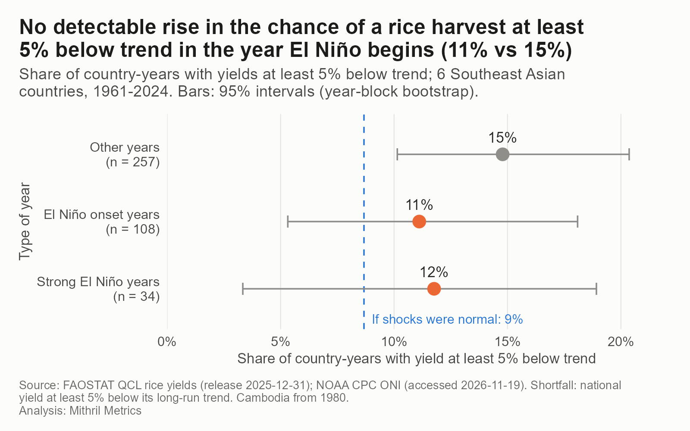

```{r}
#| label: guard
#| include: false
if (!file.exists("output/key_numbers.csv")) knitr::knit_exit("*Results pending.*")
```

```{r}
#| label: setup
#| include: false
suppressPackageStartupMessages({
  library(acutils)
  library(yaml)
})
meta    <- yaml::read_yaml("00_meta.yml", fileEncoding = "UTF-8")
kn_file <- "output/key_numbers.csv"
k <- function(key, ...) acutils::kn(key, file = kn_file, ...)
`%||%` <- function(a, b) if (is.null(a) || identical(a, "")) b else a
bullets  <- function(x) cat(paste0("- ", x), sep = "\n")
blog_url <- meta$links$blog %||% "[blog link]"
code_url <- meta$links$code %||% "[GitHub link]"
cpc_url  <- meta$hook$primary_source$url
appeal_url <- "https://www.wfp.org/publications/el-nino-fao-wfp-joint-anticipatory-action-appeal-june-2026-march-2027"
kn_tbl <- acutils::kn_read(kn_file)
val <- function(key) kn_tbl$value[kn_tbl$key == key]
excl0 <- function(key) {                  # TRUE if the 95% interval excludes zero
  lo <- val(paste0(key, "_lo"))
  hi <- val(paste0(key, "_hi"))
  lo > 0 || hi < 0
}
pv <- function(key) {                     # "p = 0.068" or "p < 0.001"
  if (val(key) < 0.001) "p < 0.001" else paste("p =", k(key))
}
kt <- function(key) format(round(abs(val(key)), -1), big.mark = ",")   # thousand t, rounded to 10
# Ratio range: the classical-SD benchmark is the low end, the robust one the high end
r_lo <- k(if (val("ratio10_sd") <= val("ratio10")) "ratio10_sd" else "ratio10")
r_hi <- k(if (val("ratio10_sd") <= val("ratio10")) "ratio10" else "ratio10_sd")
ratio_range <- paste(r_lo, "to", r_hi)
old_share <- val("n_loss10_pre1980") / val("n_loss10")
old_txt <- if (old_share > 0.5) {
  paste0("most of these deep shortfalls (", k("n_loss10_pre1980"), " of ", k("n_loss10"), ") date from before 1980")
} else {
  paste0(k("n_loss10_pre1980"), " of the ", k("n_loss10"), " deep shortfalls date from before 1980")
}
mar_sig  <- excl0("sl_s3_mar_prod_t1")
mar_down <- val("sl_s3_mar_prod_t1") < 0
diff_sig <- excl0("sl_d3_prod_t1")
mai_txt <- paste0("on the mainland ",
                  if (excl0("sl_s3_mai_prod_t1")) "the estimate is " else "there is no detectable effect (",
                  k("sl_s3_mai_prod_t1", unit = TRUE, sign = TRUE),
                  if (excl0("sl_s3_mai_prod_t1")) " (" else ", ",
                  "95% interval ", k("sl_s3_mai_prod_t1_lo", unit = TRUE), " to ",
                  k("sl_s3_mai_prod_t1_hi", unit = TRUE), ")")
diff_txt <- if (diff_sig) {
  lo_hi <- sort(abs(c(val("sl_d3_prod_t1_lo"), val("sl_d3_prod_t1_hi"))))
  paste0("The maritime effect is ", k("sl_d3_prod_t1", abs = TRUE), " percentage points ",
         if (val("sl_d3_prod_t1") < 0) "lower" else "higher", " than the mainland one (interval ",
         sprintf("%.1f", lo_hi[1]), " to ", sprintf("%.1f", lo_hi[2]), "), so the regions do differ.")
} else {
  paste0("The gap between the two regions (", k("sl_d3_prod_t1", abs = TRUE), " percentage points, interval ",
         k("sl_d3_prod_t1_lo"), " to ", k("sl_d3_prod_t1_hi"), ") is not statistically clear, so we cannot say ",
         "that the regions differ.")
}
c24_fits <- val("sl_c24_onset_prev") == 1 && val("sl_c24_mar_prod_pct") < 0
```

```{r}
#| label: shared-text
#| include: false
question <- meta$question

mar_sentence <- if (mar_sig && mar_down) {
  paste0("In an exploratory check, rice production in Indonesia, the Philippines and Malaysia runs ",
         k("sl_s3_mar_prod_t1", unit = TRUE, abs = TRUE), " below trend the year after an onset, about ",
         kt("sl_t3_mar_kt"), " thousand tonnes at ", k("sl_t3_year"), " output; ", mai_txt, ".")
} else {
  paste0("An exploratory check of the year after an onset finds rice production in Indonesia, the ",
         "Philippines and Malaysia at ", k("sl_s3_mar_prod_t1", unit = TRUE, sign = TRUE),
         " against trend, with an interval that includes zero; ", mai_txt, ".")
}

bottom_line <- paste0(
  "Not in the year it begins. Across six Southeast Asian countries since ", k("year_start"),
  ", El Niño onset years show no detectable rise in national rice shortfalls (",
  k("p5_elnino_pct", unit = TRUE), " of country-years at least 5% below trend, against ",
  k("p5_other_pct", unit = TRUE), " in other years). ", mar_sentence,
  " Harvests 10% or more below trend have come ", ratio_range, " times as often as a bell curve ",
  "predicts, depending on how normal variation is measured, and ", old_txt, "."
)

key_figures <- list(
  c(value = paste0(k("p5_elnino_pct", unit = TRUE), " vs ", k("p5_other_pct", unit = TRUE)),
    label = "Country-years at least 5% below trend: El Niño onset years vs other years"),
  if (mar_sig && mar_down) {
    c(value = paste0("-", kt("sl_t3_mar_kt"), " kt"),
      label = paste0("Rice production vs trend in Indonesia, the Philippines and Malaysia the year after an onset, at ",
                     k("sl_t3_year"), " output (exploratory)"))
  } else {
    c(value = k("sl_s3_mar_prod_t1", unit = TRUE, sign = TRUE),
      label = "Maritime rice production vs trend the year after an onset; interval includes zero (exploratory)")
  },
  c(value = paste0(r_lo, "-", r_hi, "x"),
    label = "How much more often harvests fell 10% or more below trend than a bell curve predicts, depending on the benchmark")
)

why_now <- paste0(
  "On 12 November 2026 NOAA's Climate Prediction Center reported that El Niño is still ",
  "strengthening, with a strong to very strong event likely through January to March 2027. ",
  "The three-month Niño 3.4 anomaly for August to October stood at ", k("oni_latest"),
  "°C. FAO and WFP have launched their first joint ",
  "anticipatory action appeal for this event, and rice, Southeast Asia's staple, is among the ",
  "crops most exposed. Anyone planning reserves, imports or early action needs two answers: ",
  "when do the harvest losses arrive, and how deep can they go?"
)

method_plain <- paste0(
  "We use FAOSTAT national rice yields, harvested area and production for Viet Nam, Indonesia, ",
  "the Philippines, Thailand, Malaysia and Cambodia, ", k("year_start"), " to ", k("year_end"),
  " (", k("n_obs", unit = TRUE), "). For each country we fit a smooth long-run trend and treat ",
  "the deviation from it as that year's shock. A year counts as an El Niño onset year when ",
  "NOAA's Oceanic Niño Index averages at least 0.5°C from July to December (",
  k("n_elnino_years", unit = TRUE), "). We then compare how often harvests fall at least 5% ",
  "below trend in El Niño years and in other years, within each country. Confidence intervals come ",
  "from resampling blocks of ", k("block_len"), " consecutive years, because a single El Niño hits all ",
  "six countries at once and shocks carry over from one year to the next."
)

findings <- c(
  paste0("In the year El Niño begins, no detectable rise in shortfalls: ",
         k("p5_elnino_pct", unit = TRUE), " of country-years vs ", k("p5_other_pct", unit = TRUE),
         " in other years"),
  if (mar_sig && mar_down) {
    paste0("The year after, production in Indonesia, the Philippines and Malaysia runs ",
           k("sl_s3_mar_prod_t1", unit = TRUE, abs = TRUE), " below trend, about ",
           kt("sl_t3_mar_kt"), " thousand tonnes (exploratory). No detectable effect on the mainland")
  } else {
    paste0("The year after, maritime production is ", k("sl_s3_mar_prod_t1", unit = TRUE, sign = TRUE),
           " vs trend, but the interval includes zero (exploratory)")
  },
  paste0("Harvests 10% or more below trend have come ", ratio_range,
         " times as often as a bell curve predicts", if (old_share > 0.5) ", mostly before 1980" else "")
)

implications <- c(
  paste0("If the aim is to time imports or reserve releases, the national data point, tentatively, to ",
         "the harvests after the El Niño year in the maritime countries rather than to the onset year. ",
         "Annual national totals are the level at which import and reserve decisions are made, but they ",
         "cannot show where local losses fall and they arrive too late to trigger early action. Seasonal, ",
         "subnational monitoring by national statistics offices is the operational signal."),
  paste0("If reserves or insurance are sized on variation in typical years, deep national shortfalls ",
         "have come ", ratio_range, " times as often as that implies. Most of those episodes are old, ",
         "so the gap may be smaller today. Larger buffers cost money in the many calm years, so the ",
         "choice is between that cost and the cost of a shortfall."),
  paste0("If the 2026-27 event behaves like past ones, the 2027 harvests in Indonesia, the Philippines ",
         "and Malaysia are where a national signal would show. The estimate averages ",
         k("n_elnino_years"), " past events and cannot say how this one, stronger than most, will play ",
         "out, and FAOSTAT figures for 2027 will only appear in late 2028.")
)

caveats <- c(
  paste0("These are national annual totals. A drought that halves the harvest in one province can ",
         "vanish in the national total, so the results say nothing about local losses, which is ",
         "where food insecurity concentrates. Prices and trade are outside our scope: in 2023 much of ",
         "the pressure on regional rice markets came from export restrictions rather than from harvests."),
  paste0("Timing is approximate. FAO records harvests by calendar year while cropping seasons ",
         "straddle years, so part of the year-after effect may be the same season recorded late."),
  paste0("The maritime result comes from checks added after the pre-specified test came back null. ",
         "The region split and the one-year lag were not specified in advance, and the yield-only ",
         "effect does not survive a correction for multiple testing (adjusted ",
         pv("sl_holm_mar_yield_t1"), "). Treat it as a hypothesis to test on future data, not an estimate."),
  paste0("The intervals re-estimate each country's typical variation in every draw but treat its ",
         "long-run trend as known, so they are somewhat too narrow.")
)

method_tag <- paste0("Method: detrended FAOSTAT rice data, ", k("n_countries"), " countries, ",
                     k("year_start"), "-", k("year_end"), "; country fixed effects; block-bootstrap intervals")
hashtags <- "#FoodSecurity #ElNino #AgriculturalEconomics #SoutheastAsia"

author_slug <- gsub("[^a-z]+", "-", tolower(iconv(rmarkdown::metadata$author %||% "", to = "ASCII//TRANSLIT")))
```

::: {.content-visible when-format="html"}

::: {.bottom-line}
**Short answer.** `r bottom_line`
:::

```{r}
#| label: key-figures
#| results: asis
cat('<div class="key-figures">\n')
for (f in key_figures) {
  cat('<div class="kf"><div class="kf-value">', f[["value"]], '</div><div class="kf-label">',
      f[["label"]], '</div></div>\n', sep = "")
}
cat('</div>\n')
```

## Why this matters now

`r why_now` Sources: [NOAA CPC ENSO discussion](`r cpc_url`) and the
[FAO-WFP joint appeal](`r appeal_url`).

## What we did

::: {.method-note}
`r method_plain`
:::

## What the data show

### Deep shortfalls have come more often than a bell curve predicts

{fig-alt="Line chart on a log scale of how often national rice yields in six Southeast Asian countries fell at least a given percentage below trend, `r k("year_start")`-`r k("year_end")`. Observed shortfalls of 10% or more occur `r k("ratio10")` times as often as a normal curve based on typical years predicts, and `r k("ratio10_sd")` times as often as a normal curve based on all years." width="100%"}

In a typical year, national rice yields in these countries move about
`r k("median_sigma_pct", unit = TRUE)` around their trend. A bell curve with that spread
predicts a harvest 10% or more below trend in `r k("p10_normal_pct", unit = TRUE)` of
country-years. It happened in `r k("p10_obs_pct", unit = TRUE)`: `r k("n_loss10")` of
`r k("n_obs")` country-years, or `r k("ratio10")` times as often (95% interval
`r k("ratio10_lo")` to `r k("ratio10_hi")`, allowing for uncertainty in each country's typical
variation). A bell curve stretched to cover all years, bad ones included, fits the 10% threshold
much better: `r k("ratio10_sd")` times (interval `r k("ratio10_sd_lo")` to `r k("ratio10_sd_hi")`),
`r if (val("ratio10_sd_lo") <= 1) "which does not rule out the bell curve" else "still above what it predicts"`.
A formal estimate of the tail shape is close to zero (`r k("gpd_xi")`, interval `r k("gpd_xi_lo")`
to `r k("gpd_xi_hi")`).

The answer therefore depends on the benchmark, and the honest range is `r ratio_range` times.
Timing matters too: `r old_txt`. We read this as long calm stretches broken by a few sharp,
mostly older shocks, rather than a smoothly fat tail. The gap holds when we drop the major
conflict years (`r k("sl_s4_noconflict_ratio10")` times on the typical-year benchmark) or the
1997-98 Asian crisis (`r k("sl_s4_nocrisis_ratio10")` times). A reserve or insurance product
calibrated on typical years would have underpriced the bad years in the past; how much it would
today is less clear.

### In the year El Niño begins, no detectable rise

{fig-alt="Dot chart with 95% intervals: `r k("p5_elnino_pct", unit = TRUE)` of El Niño onset country-years and `r k("p5_strong_pct", unit = TRUE)` of strong El Niño country-years had rice yields at least 5% below trend, against `r k("p5_other_pct", unit = TRUE)` of other years." width="100%"}

El Niño onset years had a shortfall of 5% or more in `r k("p5_elnino_pct", unit = TRUE)` of
country-years, against `r k("p5_other_pct", unit = TRUE)` in other years. The difference
within countries is `r k("diff5_pp")` percentage points (95% interval `r k("diff5_lo_pp")` to
`r k("diff5_hi_pp")`). That rules out a large increase but not a modest one. Strong events look
no different (`r k("p5_strong_pct", unit = TRUE)`), and only
`r k("share_worst_elnino_pct", unit = TRUE)` of the worst tenth of harvests fell in onset
years, which make up `r k("share_obs_elnino_pct", unit = TRUE)` of all years. Harvested area
changes by `r k("sl_s2_area_t", unit = TRUE, sign = TRUE)` in the onset year (interval
`r k("sl_s2_area_t_lo", unit = TRUE)` to `r k("sl_s2_area_t_hi", unit = TRUE)`; adjusted
`r pv("sl_holm_area_t")` after the multiple-testing correction).

### A possible signal a year later, in maritime Southeast Asia

{fig-alt="Dot chart of El Niño effects on rice yield, harvested area and production, in the onset year and the year after, for all six countries, maritime and mainland Southeast Asia. Maritime production the year after onset is `r k("sl_s3_mar_prod_t1", unit = TRUE)` against trend; on the mainland it is `r k("sl_s3_mai_prod_t1", unit = TRUE, sign = TRUE)`." width="100%"}

A July to December El Niño often hits a harvest that FAO records in the following calendar
year, so we also looked at the year after onset, and at yield, area and production separately.
These checks were added after the main result came back null, so they are exploratory. The
pre-specified version, the chance of a 5% yield shortfall the year after, shows nothing clear
(`r k("r1_diff5_pp")` percentage points, interval `r k("r1_lo_pp")` to `r k("r1_hi_pp")`).

In Indonesia, the Philippines and Malaysia, rice production runs
`r k("sl_s3_mar_prod_t1", unit = TRUE, sign = TRUE)` against trend the year after an onset (95%
interval `r k("sl_s3_mar_prod_t1_lo", unit = TRUE)` to `r k("sl_s3_mar_prod_t1_hi", unit = TRUE)`;
adjusted `r pv("sl_holm_mar_prod_t1")` across `r k("sl_n_margin_tests")` tested effects).
Dropping one El Niño event at a time (with the year after it) leaves it between
`r k("sl_loo_min", unit = TRUE)` and `r k("sl_loo_max", unit = TRUE)`. Weighting countries by
their output, so that Indonesia counts most, gives `r k("sl_w3_mar_prod_t1", unit = TRUE, sign = TRUE)`
(interval `r k("sl_w3_mar_prod_t1_lo", unit = TRUE)` to `r k("sl_w3_mar_prod_t1_hi", unit = TRUE)`).
At `r k("sl_t3_year")` trend output, the unweighted estimate is
`r k("sl_t3_mar_kt", sign = TRUE)` thousand tonnes (interval `r k("sl_t3_mar_lo_kt", sign = TRUE)` to
`r k("sl_t3_mar_hi_kt", sign = TRUE)`), of which Indonesia `r k("sl_t3_idn_kt", sign = TRUE)`. These are gaps
against each country's long-run trend, not falls from the previous year, so they are not comparable
with the year-on-year changes usually reported. In contrast, `r mai_txt`. `r diff_txt`

`r if (c24_fits) paste0("The latest case points the same way: in ", k("sl_t3_year"), ", the harvest year after the 2023 onset, maritime production was ", k("sl_c24_mar_prod_pct", unit = TRUE, abs = TRUE), " below trend (Indonesia ", k("sl_c24_idn_prod_pct", unit = TRUE, sign = TRUE), "). That year is part of the sample, so it illustrates the estimate rather than testing it.") else paste0("The latest case does not follow the pattern: in ", k("sl_t3_year"), " maritime production was ", k("sl_c24_mar_prod_pct", unit = TRUE, sign = TRUE), " against trend.")`

One reading, which these data cannot test, is that El Niño droughts delay the main wet-season
planting on the islands, pushing part of the harvest into the next calendar year, while
irrigated deltas on the mainland buffer them.

## What this means for policy

```{r}
#| results: asis
bullets(implications)
```

::: {.caveats}
## Caveats

```{r}
#| results: asis
bullets(caveats)
```
:::

::: {.data-code}
## Data & code

```{r}
#| results: asis
src <- Filter(function(s) !is.null(s$name), meta$sources)
bullets(vapply(src, function(s) paste0(
  "**", s$name, "**", if (!is.null(s$table)) paste0(" (", s$table, ")") else "",
  if (!is.null(s$version)) paste0(", version ", s$version) else "",
  if (!is.null(s$accessed)) paste0(", accessed ", s$accessed) else "",
  if (!is.null(s$url)) paste0(". [Link](", s$url, ")") else ""), ""))
cat("\nCode to reproduce every number and figure: [GitHub](", code_url, "). ",
    "One-page brief: [PDF](brief.pdf).\n", sep = "")
```

**Use of AI tools.** We use Claude, an AI assistant by Anthropic, as a working tool: to help with coding, data retrieval scripts and first drafts of text. Questions, methods, robustness checks and conclusions are our own, every number is reproducible from the published code, and we review all text before it goes online.
:::

```{r}
#| label: post-footer
#| results: asis
photo <- file.path("..", "..", "images", "people", paste0(author_slug, ".jpg"))
cat('<div class="post-footer">',
    if (nzchar(author_slug)) paste0('') else "",
    '<p>Written by <a href="../../people/', author_slug, '.html">', rmarkdown::metadata$author,
    '</a>. Views are the authors\' own. Part of <em>Mithril Metrics</em>: short, reproducible analyses ',
    'of current agri-food, water and climate policy questions.</p></div>\n', sep = "")
```

:::

::: {.content-visible when-format="typst"}

**Question.** Does El Niño bring unusually severe rice shortfalls in Southeast Asia?

**Short answer.** `r bottom_line`

{width="60%"}

**What this means for policy**

```{r}
#| results: asis
bullets(implications[1:2])
```

**Caveats**

```{r}
#| results: asis
bullets(caveats[c(1, 3)])
```

```{r}
#| label: brief-sources
#| include: false
src_brief <- vapply(Filter(function(s) !is.null(s$name), meta$sources), function(s)
  paste0(s$name, if (!is.null(s$accessed)) paste0(" (accessed ", s$accessed, ")") else ""), "")
src_brief <- paste(src_brief, collapse = "; ")
```

**Data & code.** `r src_brief`. Code: [GitHub, Mithril-Metrics](`r code_url`).

```{=typst}
#text(size: 9pt, fill: rgb("#5b6876"))[`r rmarkdown::metadata$author` · Views are the authors' own. Mithril Metrics · mithril-metrics.github.io]
```

```{=typst}
#text(size: 8pt, fill: rgb("#5b6876"))[*Use of AI tools.* We use Claude, an AI assistant by Anthropic, as a working tool: to help with coding, data retrieval scripts and first drafts of text. Questions, methods, robustness checks and conclusions are our own, every number is reproducible from the published code, and we review all text before it goes online.]
```

:::

```{r}
#| label: linkedin
#| include: false
hook <- paste0("This El Niño is among the strongest on record. In Southeast Asian rice data since ",
               k("year_start"), ", the year El Niño begins shows no detectable national rice losses.")
li_why <- paste0("FAO and WFP have launched their first joint anticipatory action appeal for this ",
                 "event. So we asked: when do El Niño's rice losses show up, and how deep can they go?")
li <- paste0(
  hook, "\n\n",
  li_why, "\n\n",
  "What we found:\n", paste0("→ ", findings, collapse = "\n"), "\n\n",
  "What it means: for timing imports or reserves, the national data point, tentatively, to the ",
  "harvests after the El Niño year. Buffers sized on typical years have been too thin for the bad ",
  "ones in the past.\n\n",
  "National annual totals hide local losses and arrive late, so early action still needs seasonal, ",
  "provincial data.\n\n",
  method_tag, "\n",
  "Full analysis and code: link in the first comment\n\n",
  hashtags
)
dir.create("output", showWarnings = FALSE)
writeLines(li, "output/linkedin_post.txt", useBytes = TRUE)
writeLines(paste0("Full analysis and code: ", blog_url), "output/linkedin_first_comment.txt", useBytes = TRUE)

n_total <- nchar(li, type = "chars")
n_hook  <- nchar(hook, type = "chars")
checks <- c(
  sprintf("LinkedIn post: %d characters (limit %d) %s", n_total, params$linkedin_max_chars,
          if (n_total <= params$linkedin_max_chars) "OK" else "TOO LONG"),
  sprintf("Hook: %d characters (aim <= %d) %s", n_hook, params$linkedin_hook_max_chars,
          if (n_hook <= params$linkedin_hook_max_chars) "OK" else "TOO LONG"),
  sprintf("Placeholders left: %s", if (grepl("\\[|Placeholder", li)) "YES - edit before posting" else "none")
)
writeLines(checks, "output/linkedin_check.txt")
message(paste(checks, collapse = "\n"))
too_long <- n_total > params$linkedin_max_chars || n_hook > params$linkedin_hook_max_chars
if (too_long && isTRUE(params$strict)) stop(paste(checks, collapse = "\n"))
if (too_long) warning(paste(checks, collapse = "\n"))
```
