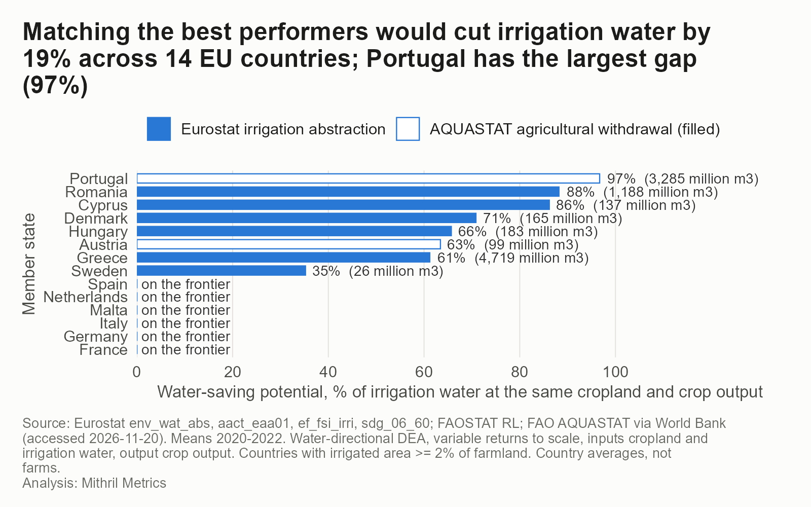
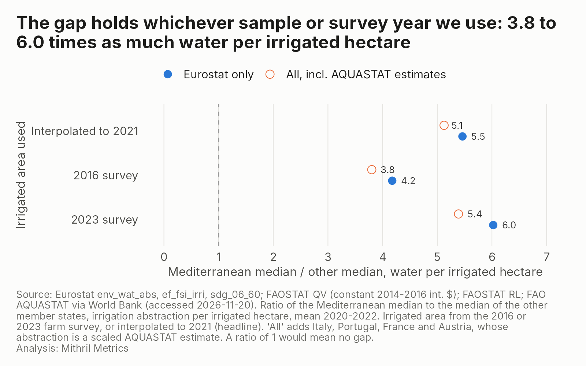
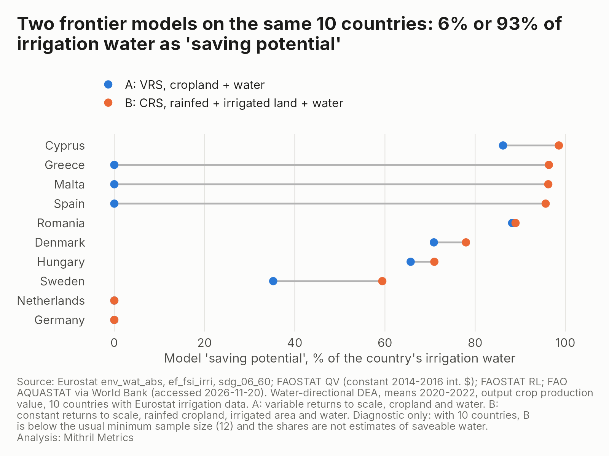

```{r}
#| label: guard
#| include: false
# Before the analysis has been run there are no results: stop knitting here, so the
# website build on GitHub does not fail while a case is still in progress.
if (!file.exists("output/key_numbers.csv")) knitr::knit_exit("*Results pending.*")
```

```{r}
#| label: setup
#| include: false
suppressPackageStartupMessages({
  library(acutils)
  library(yaml)
})
meta    <- yaml::read_yaml("00_meta.yml", fileEncoding = "UTF-8")
kn_file <- "output/key_numbers.csv"
k <- function(key, ...) acutils::kn(key, file = kn_file, ...)   # formatted key number
kn_tbl  <- acutils::kn_read(kn_file)
`%||%` <- function(a, b) if (is.null(a) || identical(a, "")) b else a
bold_first <- function(x) unname(vapply(x, function(s) {   # PDF: bold the first sentence, or its lead clause if long
  sent <- sub("^(.+?[.:])( .*|)$", "\\1", s, perl = TRUE)
  lead <- sent
  if (length(strsplit(sent, " ")[[1]]) > 16) {
    cl <- sub("^(.+?[,;])( .*|)$", "\\1", s, perl = TRUE)
    if (cl != s) lead <- cl
  }
  paste0("**", lead, "**", substring(s, nchar(lead) + 1))
}, ""))
bullets  <- function(x) cat(paste0("- ", x), sep = "\n")
site_url <- "https://mithril-metrics.github.io"   # same for both authors
case_id  <- meta$id %||% basename(getwd())
blog_url <- meta$links$blog %||% paste0(site_url, "/cases/", case_id, "/report.html")
code_url <- meta$links$code %||% paste0("https://github.com/Mithril-Metrics/mithril-metrics.github.io/tree/main/cases/", case_id)
```

```{r}
#| label: shared-text
#| include: false
# Written once; feeds the blog, the brief and the LinkedIn post.
question <- "Can one EU-wide benchmark rank irrigation water efficiency across member states?"

ratio_rng <- paste0(k("ratio_min"), " to ", k("ratio_max"))
ratio_and <- paste0(k("ratio_min"), " and ", k("ratio_max"))

bottom_line <- paste0(
  "**Not on its own.** In the ", k("n_main"), " member states with Eurostat irrigation data, ",
  "Mediterranean countries abstract ", k("m3ha_ratio"), " times more irrigation water per irrigated ",
  "hectare than the rest (median ", k("m3ha_med"), " against ", k("m3ha_other"), " m³/ha, ",
  k("year_start"), "–", k("year_end"), "), and the gap stays between ", ratio_and, " times across ",
  "samples and survey years. We cannot separate climate from crop mix and infrastructure in that gap, ",
  "so we infer that a ranking across countries would mostly show where a country is, not how well it ",
  "irrigates."
)

why_now <- paste0(
  "On 22 October 2026, France and Portugal, backed by Cyprus, Czechia, Hungary and Slovakia, ",
  "asked EU agriculture ministers for action to reduce average water use per irrigated hectare ",
  "and to ease EU funding of farm water infrastructure. Ministers discussed the note at the ",
  "AGRIFISH Council on 26–27 October, and on 27 October the Commission proposed a European Climate ",
  "Resilience Law that makes water security a mandatory part of national climate-risk plans. ",
  "Both build on the 2025 Water Resilience Strategy and its target of ", k("ref_wrs_target"),
  "% better water efficiency by 2030. Water per irrigated hectare is the obvious indicator for ",
  "tracking this. We asked whether it can also be compared across countries."
)

method_plain <- paste0(
  "We divided Eurostat's irrigation abstraction (mean ", k("year_start"), "–",
  k("year_end"), ") by the irrigated area from the 2016 and 2023 farm surveys, for the ",
  k("n_all"), " member states where at least ", k("irr_threshold"), "% of farmland is irrigated, ",
  "and compared countries with a Mediterranean climate with the rest. An exact rank test asks how ",
  "likely a split this clean would be if the climate group made no difference. The headline uses the ",
  k("n_main"), " countries with Eurostat irrigation data. We also tried a frontier model (data ",
  "envelopment analysis) to adjust for land and crop value; with ", k("n_main"), " countries it gives ",
  "no stable answer, so it is in the technical note only. We set out to rank countries; after our ",
  "first two model runs we changed the question and chose the climate grouping."
)

findings <- c(
  paste0("Mediterranean member states abstract ", k("m3ha_ratio"), " times more irrigation water per ",
         "irrigated hectare than the rest (median ", k("m3ha_med"), " vs ", k("m3ha_other"), " m³/ha)"),
  paste0("Each of the ", k("n_main_med"), " Mediterranean countries with Eurostat data abstracts more ",
         "per hectare than each of the ", k("n_main_other"), " others, from Greece (", k("m3ha_max"),
         " m³/ha) down to Germany (", k("m3ha_min"), ")"),
  paste0("The gap stays between ", ratio_and, " times whichever sample or survey year we use")
)

implications <- c(
  paste0("If the aim is to track progress towards the ", k("ref_wrs_target"), "% efficiency ",
         "target, then measuring each country against its own baseline, as current EU texts do, ",
         "sidesteps the climate gap. The trade-off is that it says nothing about where the room ",
         "for improvement is largest."),
  paste0("If a per-hectare indicator were used to compare countries, set eligibility or ",
         "allocate EU funds, then it would need to account for crop water requirements, crop mix ",
         "and infrastructure, for example through climate-adjusted or river-basin benchmarks. ",
         "The trade-off is more data and less simplicity."),
  paste0("If a common per-hectare threshold were applied, most of the adjustment would fall on ",
         "Mediterranean irrigators. Whether that is justified depends on basin-level and seasonal ",
         "scarcity, which national annual averages do not show.")
)

caveats <- c(
  paste0("We do not separate climate from crop mix, irrigation infrastructure and national ",
         "reporting practice. The Mediterranean grouping and this framing were chosen after our ",
         "first two model runs, so the rank test is exploratory."),
  paste0("The data measure water abstracted, not water applied at the field, as national annual ",
         "averages that hide basin and seasonal stress. Italy, Portugal, France and Austria have no ",
         "Eurostat irrigation figures; their scaled AQUASTAT estimates are shown but not used (France's ",
         "national statistics give ", k("ref_fr_m3ha"), " m³/ha for 2020, well above our estimate)."),
  paste0("With ", k("n_main"), " countries and national averages, we cannot adjust the gap for ",
         "climate. A frontier model on this sample does not help: two common versions put the ",
         "'saving potential' at ", k("share_a"), "% or ", k("share_b"), "% of irrigation water (see the ",
         "technical note).")
)

key_figures <- list(
  c(value = paste0(ratio_rng, "×"),
    label = "Irrigation water per irrigated hectare, Mediterranean vs other member states"),
  c(value = paste0(k("m3ha_med"), " vs ", k("m3ha_other")),
    label = "Median m³ per irrigated hectare, 2020–2022"),
  c(value = paste0(k("n_main_med"), " of ", k("n_main_med")),
    label = paste0("Mediterranean countries above all ", k("n_main_other"),
                   " others with Eurostat data (exact p = ", k("p_ranksum"), ")"))
)

# ---- Technical note (PDF) only: more detail than the blog ----
method_detail <- paste0(
  "**We compare water abstracted per irrigated hectare across member states, then check whether a ",
  "frontier model could adjust the comparison.** *Data.* Eurostat irrigation water abstraction ",
  "(env_wat_abs, mean ", k("year_start"), "-", k("year_end"), "), irrigated area from the Eurostat farm ",
  "structure surveys (2016 and 2023, interpolated to 2021), FAOSTAT cropland and crop gross production ",
  "value (constant international dollars), and the Eurostat water exploitation index (WEI+). *Sample.* The ",
  k("n_all"), " member states where at least ", k("irr_threshold"), "% of farmland is irrigated; the headline ",
  "uses the ", k("n_main"), " with Eurostat irrigation data. The ", k("n_filled"), " others (Italy, Portugal, ",
  "France, Austria) have AQUASTAT-based estimates, scaled by the median Eurostat/AQUASTAT ratio and shown ",
  "but not used in the headline. *Comparison.* Water per irrigated hectare in Mediterranean-climate member ",
  "states (Cyprus, Greece, Spain, Italy, Malta, Portugal) against the rest: ratio of medians and an exact ",
  "rank-sum test, recomputed for both samples and for irrigated area from each survey year. *Frontier ",
  "diagnostic (Section 3).* Water-directional data envelopment analysis under four specifications. ",
  "*Identification.* Descriptive: we do not estimate efficiency net of climate, and no country is called ",
  "inefficient."
)
results_note <- c(
  paste0("**Mediterranean countries abstract far more water per irrigated hectare.** Median ", k("m3ha_med"),
         " against ", k("m3ha_other"), " m³/ha (", k("n_main_med"), " against ", k("n_main_other"),
         " countries), a ratio of ", k("m3ha_ratio"), ". Every Mediterranean country is above every other ",
         "(exact rank-sum p = ", k("p_ranksum"), ", the smallest possible with groups this size; all ",
         k("n_all"), " countries: p = ", k("p_ranksum_all"), ", but Portugal's estimate falls below Romania)."),
  paste0("**The range is wide.** From ", k("m3ha_max"), " m³/ha in Greece to ", k("m3ha_min"),
         " in Germany."),
  paste0("**Water per hectare follows water stress.** Rank correlation with the water exploitation index: ",
         k("rho_m3ha_wei"), " (partly mechanical: abstraction enters both).")
)
robustness <- c(
  paste0("**The per-hectare gap is stable.** Ratio of medians with the ", k("n_main"), " Eurostat countries: ",
         k("ratio_main"), " (irrigated area interpolated to 2021), ", k("ratio_main_2016"), " (2016 survey), ",
         k("ratio_main_2023"), " (2023 survey). With all ", k("n_all"), ": ", k("ratio_all"), ", ",
         k("ratio_all_2016"), " and ", k("ratio_all_2023"), "."),
  paste0("**The estimates for the four filled countries are rough.** We scale AQUASTAT by the median ",
         "Eurostat/AQUASTAT ratio over ", k("n_fill_check"), " member states (", k("fill_ratio"), "%), but the ",
         "ratio follows climate: ", k("fill_ratio_med"), "% in the Mediterranean countries with both figures. ",
         "Italy's and Portugal's estimates are therefore probably too low, and France's is below its national ",
         "figure of ", k("ref_fr_m3ha"), " m³/ha for 2020. The net effect on the ratio with all ", k("n_all"),
         " countries is unclear, which is why the headline uses Eurostat countries only; even France's national ",
         "figure is below every Mediterranean country with Eurostat data."),
  "**Not tested:** a comparison net of crop water requirements, for example per-hectare water relative to the growing-season water deficit."
)
dea_note <- c(
  paste0("**Too few countries for the number of inputs.** A common rule of thumb asks for at least ",
         "max(m·s, 3(m+s)) units with m inputs and s outputs: ", k("rot_a"), " for model A (2 inputs, ",
         "1 output) and ", k("rot_b"), " for model B (3 inputs). We have ", k("n_main"), ": B fails the rule ",
         "and A passes it only just. Under variable returns, ", k("nfront_a"), " of ", k("n_main"),
         " countries sit on the frontier."),
  paste0("**One modelling choice decides the answer.** Variable returns give a saving potential of ",
         k("share_a"), "% of sample water (", k("share_b_vrs"), "% with land split), constant returns ",
         k("share_b"), "% (", k("share_a_crs"), "% with total cropland). Switching returns to scale ",
         "moves the share by ", k("d_rts"), " points on average; splitting land into rainfed and irrigated ",
         "moves it by ", k("d_land"), ". The two models' country rankings barely agree (rank correlation ",
         k("rho_ab"), ")."),
  paste0("**Model B mostly ranks crop value per m³.** Crop value includes rainfed output, so it ranges from ",
         k("ppm_min"), " int. $ per m³ of irrigation water in Cyprus to ", k("ppm_max"), " in Germany. ",
         "B's saving share has a rank correlation of ", k("rho_b_ppm"), " with it and ", k("rho_b_m3ha"),
         " with water per hectare; Germany and the Netherlands, where most crop output is rainfed, set ",
         "the frontier."),
  paste0("**Single-country results are fragile.** Dropping one frontier country moves a country's ",
         "saving share by up to ", k("loo_shift_a"), " points (A) and ", k("loo_shift_b"), " points (B)."),
  paste0("**Conclusion.** A national frontier with ", k("n_main"), " countries cannot separate efficiency ",
         "from climate and crop mix, and none of these shares is an estimate of water farms could save. ",
         "A regional frontier with a climate input (for example the growing-season water deficit) is the ",
         "natural next step.")
)
references <- c(
  "France and Portugal (2026). Note to the Agriculture and Fisheries Council, 22 October 2026. [consilium.europa.eu](https://data.consilium.europa.eu/doc/document/ST-14698-2026-INIT/x/pdf)",
  "European Commission (2025). Water Resilience Strategy, June 2025. [ec.europa.eu](https://cyprus.representation.ec.europa.eu/news/commission-launches-strategy-enhance-water-security-people-economy-and-environment-2025-06-04_en)",
  "European Commission (2026). Proposal for a European Climate Resilience Law, 27 October 2026. [commission.europa.eu](https://commission.europa.eu/news-and-media/news/protecting-europe-stronger-climate-resilience-2026-10-27_en)",
  "INSEE (2020). Irrigation statistics for France. [insee.fr](https://www.insee.fr/fr/statistiques/7728881)",
  "Cooper, W. W., Seiford, L. M. and Tone, K. (2007). Data Envelopment Analysis, 2nd ed. Springer."
)

author_slug <- gsub("[^a-z]+", "-", tolower(iconv(rmarkdown::metadata$author %||% "", to = "ASCII//TRANSLIT")))

method_tag <- paste0("Method: water per irrigated hectare and an exact rank test, ", k("n_all"),
                     " EU member states, ", k("year_start"), "–", k("year_end"), ".")
hashtags   <- "#AgriculturalEconomics #WaterPolicy #Irrigation"
```

::: {.content-visible when-format="html"}

::: {.bottom-line}
**Short answer.** `r bottom_line`
:::

```{r}
#| label: key-figures
#| results: asis
cat('<div class="key-figures">\n')
for (f in key_figures) {
  cat('<div class="kf"><div class="kf-value">', f[["value"]], '</div><div class="kf-label">',
      f[["label"]], '</div></div>\n', sep = "")
}
cat('</div>\n')
```

## Why this matters now

`r why_now` [Primary source](`r meta$hook$primary_source$url %||% "#"`).

## What we did

::: {.method-note}
`r method_plain`
:::

## What the data show

### Where Eurostat has the data, every Mediterranean country abstracts more per hectare than every other

{fig-alt="Horizontal bar chart of irrigation water abstracted per irrigated hectare in EU member states, 2020 to 2022. Greece, Malta, Cyprus and Spain are highest; Germany and the Netherlands are lowest. Italy, Portugal, Austria and France are shown as hollow bars because their figures are estimates." width="100%"}

**Among the `r k("n_main")` countries with Eurostat irrigation data, all `r k("n_main_med")`
Mediterranean ones abstract more water per irrigated hectare than all `r k("n_main_other")` others**
(exact rank-sum p = `r k("p_ranksum")`, the smallest possible with groups this size). Greece
abstracts the most, `r k("m3ha_max")` m³ per irrigated hectare, and Germany the least,
`r k("m3ha_min")`. The ratio of the medians is `r ratio_rng`, depending on the survey year used for
irrigated area and on whether the `r k("n_filled")` estimated countries are included.

We infer that a cross-country comparison on this indicator would mainly sort countries by where they
are. How much of the gap is climate and how much is crop mix (vegetables, orchards and rice in the
south), conveyance losses or reporting practice, we do not test.

### The gap holds whichever sample or survey year we use

{fig-alt="Dot chart of the ratio between the Mediterranean and the other member states' median water per irrigated hectare under six variants: with only the 10 countries with Eurostat data or all 14, and irrigated area from the 2016 survey, the 2023 survey or interpolated to 2021. All six ratios lie between 3.8 and 6.0." width="100%"}

**The ratio of the medians stays between `r ratio_and`**, whether we use the `r k("n_main")` countries
with Eurostat data or all `r k("n_all")`, and whichever farm survey we take irrigated area from. Adding
the `r k("n_filled")` estimated countries lowers it slightly in each case.

Could a frontier model adjust for climate and crop mix? We tried data envelopment analysis, which
compares each country with the best observed mix of land, water and crop value. With `r k("n_main")`
countries, two common versions put the "saving potential" at `r k("share_a")`% or `r k("share_b")`% of
irrigation water, depending mainly on one modelling choice. The technical note explains why we use
neither.

## What this means for policy

```{r}
#| results: asis
bullets(implications)
```

Current EU texts already lean towards the first option: the Commission's recommendation leaves each
member state to set its own efficiency target based on national circumstances
([European Commission, June 2025](https://cyprus.representation.ec.europa.eu/news/commission-launches-strategy-enhance-water-security-people-economy-and-environment-2025-06-04_en)),
and the Council note asks for lower water use per hectare without a cross-country yardstick.

::: {.caveats}
## Caveats

```{r}
#| results: asis
bullets(caveats)
```
:::

::: {.data-code}
## Data & code

```{r}
#| results: asis
src <- Filter(function(s) !is.null(s$name), meta$sources)
if (length(src)) {
  bullets(vapply(src, function(s) paste0(
    "**", s$name, "**", if (!is.null(s$table)) paste0(" (", s$table, ")") else "",
    if (!is.null(s$version)) paste0(", version ", s$version) else "",
    if (!is.null(s$accessed)) paste0(", accessed ", s$accessed) else "",
    if (!is.null(s$url)) paste0(". [Link](", s$url, ")") else ""), ""))
} else {
  cat("- *Fill `sources` in 00_meta.yml.*\n")
}
cat("\nCode to reproduce every number and figure: [GitHub](", code_url, "). ",
    "Technical note with more detail (PDF, 2-3 pages): [brief.pdf](brief.pdf).\n", sep = "")
```

**Use of AI tools.** We use Claude, an AI assistant by Anthropic, as a working tool: to help with coding, data retrieval scripts and first drafts of text. Questions, methods, robustness checks and conclusions are our own, every number is reproducible from the published code, and we review all text before it goes online.
:::

```{r}
#| label: post-footer
#| results: asis
photo <- file.path("..", "..", "images", "people", paste0(author_slug, ".jpg"))
cat('<div class="post-footer">',
    if (nzchar(author_slug)) paste0('') else "",
    '<p>Written by <a href="../../people/', author_slug, '.html">', rmarkdown::metadata$author,
    '</a>. Views are the authors\' own. Part of <em>Mithril Metrics</em>: reproducible analyses ',
    'of current agri-food, water and climate policy questions.</p></div>\n', sep = "")
```

:::

::: {.content-visible when-format="typst"}

**Question.** `r question`

**Short answer.** `r bottom_line`

**1. Data and method**

`r method_detail`

**2. Results**

{width="62%"}

```{r}
#| results: asis
bullets(results_note)
```

**3. Robustness and exploratory checks**

```{r}
#| results: asis
bullets(robustness)
```

*Why a national frontier gives no answer here.* We also ran water-directional data envelopment analysis,
which asks how much water each country could drop at fixed land and crop value if it matched the best
observed combination, under four specifications (variable or constant returns to scale; total cropland or
rainfed plus irrigated land).

{width="55%"}

```{r}
#| results: asis
bullets(dea_note)
```

**4. What this means for policy**

```{r}
#| results: asis
bullets(bold_first(implications))
```

**5. Caveats**

```{r}
#| results: asis
bullets(bold_first(caveats))
```

**References**

```{r}
#| results: asis
bullets(references)
```

```{r}
#| label: brief-sources
#| include: false
src_brief <- vapply(Filter(function(s) !is.null(s$name), meta$sources), function(s)
  paste0(s$name, if (!is.null(s$accessed)) paste0(" (accessed ", s$accessed, ")") else ""), "")
if (!length(src_brief)) src_brief <- "[fill sources in 00_meta.yml]"
```

**Data and code**

```{r}
#| results: asis
bullets(c(src_brief, paste0("Code: [GitHub, Mithril-Metrics](", code_url, ")")))
```

```{=typst}
#text(size: 9pt, fill: rgb("#5b6876"))[`r rmarkdown::metadata$author` · Views are the authors' own. Mithril Metrics · mithril-metrics.github.io]
```

```{=typst}
#text(size: 8pt, fill: rgb("#5b6876"))[*Use of AI tools.* We use Claude, an AI assistant by Anthropic, as a working tool: to help with coding, data retrieval scripts and first drafts of text. Questions, methods, robustness checks and conclusions are our own, every number is reproducible from the published code, and we review all text before it goes online.]
```

:::

```{r}
#| label: linkedin
#| include: false
# Section B: LinkedIn post, built from the same strings and key numbers (finalised at P9).
hooks <- c(
  question = paste0("Should the EU compare countries on irrigation water per hectare? Mediterranean ",
                    "member states abstract ", ratio_rng, " times more per irrigated hectare than the rest."),
  extremes = paste0("Greece abstracts ", k("m3ha_max"), " m³ of irrigation water per irrigated hectare, ",
                    "Germany ", k("m3ha_min"), ". Before the EU compares countries on this indicator, it ",
                    "helps to ask what the gap measures."),
  answer = paste0("One EU-wide benchmark for irrigation water per hectare would mostly sort countries by ",
                  "where they are: Mediterranean member states abstract ", k("m3ha_ratio"), " times more ",
                  "per hectare than the rest.")
)
hook_choice <- "extremes"   # chosen at P9 by JPH (2026-11-26)
hook <- hooks[[hook_choice]]
writeLines(sprintf("[%s] %d characters: %s", names(hooks), nchar(hooks), hooks), "output/linkedin_hooks.txt",
           useBytes = TRUE)
li_why <- paste0("On 22 October France and Portugal asked EU ministers to cut water use per irrigated ",
                 "hectare; the EU targets ", k("ref_wrs_target"), "% better water efficiency by 2030. We asked ",
                 "whether that indicator can compare countries.")
findings_li <- findings
if (hook_choice == "extremes") {   # the hook already names Greece and Germany
  findings_li[2] <- paste0("Each of the ", k("n_main_med"), " Mediterranean countries with Eurostat data ",
                           "abstracts more per hectare than each of the ", k("n_main_other"), " others")
}
li <- paste0(
  hook, "\n\n",
  li_why, "\n\n",
  "What we found:\n", paste0("→ ", findings_li, collapse = "\n"), "\n\n",
  "What it means: ", implications[2], "\n\n",
  method_tag, "\n",
  "Full analysis and code: link in the first comment\n\n",
  hashtags
)
dir.create("output", showWarnings = FALSE)
writeLines(li, "output/linkedin_post.txt", useBytes = TRUE)
writeLines(paste0("Full analysis and code: ", blog_url), "output/linkedin_first_comment.txt", useBytes = TRUE)

n_total <- nchar(li, type = "chars")
n_hook  <- nchar(hook, type = "chars")
checks <- c(
  sprintf("LinkedIn post: %d characters (limit %d) %s", n_total, params$linkedin_max_chars,
          if (n_total <= params$linkedin_max_chars) "OK" else "TOO LONG"),
  sprintf("Hook: %d characters (aim <= %d, approx. visible before 'see more') %s", n_hook,
          params$linkedin_hook_max_chars,
          if (n_hook <= params$linkedin_hook_max_chars) "OK" else "TOO LONG"),
  sprintf("Placeholders left: %s", if (grepl("\\[|Placeholder", li)) "YES - edit before posting" else "none")
)
writeLines(checks, "output/linkedin_check.txt")
message(paste(checks, collapse = "\n"))
too_long <- n_total > params$linkedin_max_chars || n_hook > params$linkedin_hook_max_chars
if (too_long && isTRUE(params$strict)) stop(paste(checks, collapse = "\n"))
if (too_long) warning(paste(checks, collapse = "\n"))
```
