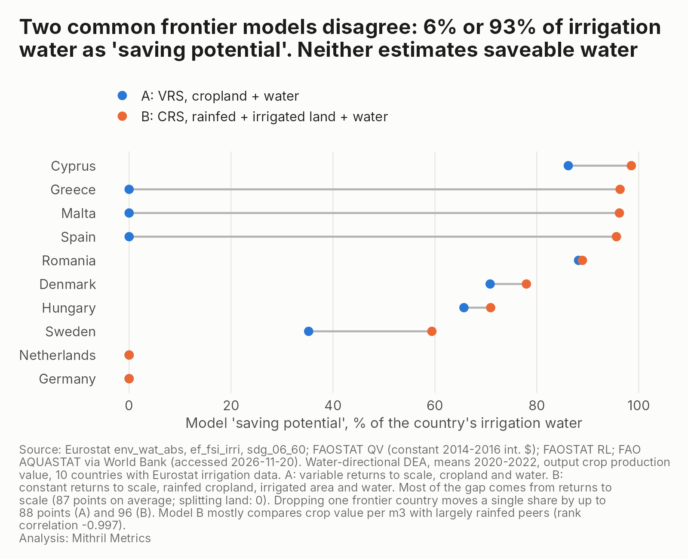

```{r}
#| label: guard
#| include: false
# Before the analysis has been run there are no results: stop knitting here, so the
# website build on GitHub does not fail while a case is still in progress.
if (!file.exists("output/key_numbers.csv")) knitr::knit_exit("*Results pending.*")
```

```{r}
#| label: setup
#| include: false
suppressPackageStartupMessages({
  library(acutils)
  library(yaml)
})
meta    <- yaml::read_yaml("00_meta.yml", fileEncoding = "UTF-8")
kn_file <- "output/key_numbers.csv"
k <- function(key, ...) acutils::kn(key, file = kn_file, ...)   # formatted key number
kn_tbl  <- acutils::kn_read(kn_file)
`%||%` <- function(a, b) if (is.null(a) || identical(a, "")) b else a
bold_first <- function(x) unname(vapply(x, function(s) {   # PDF: bold the first sentence, or its lead clause if long
  sent <- sub("^(.+?[.:])( .*|)$", "\\1", s, perl = TRUE)
  lead <- sent
  if (length(strsplit(sent, " ")[[1]]) > 16) {
    cl <- sub("^(.+?[,;])( .*|)$", "\\1", s, perl = TRUE)
    if (cl != s) lead <- cl
  }
  paste0("**", lead, "**", substring(s, nchar(lead) + 1))
}, ""))
bullets  <- function(x) cat(paste0("- ", x), sep = "\n")
site_url <- "https://mithril-metrics.github.io"   # same for both authors
case_id  <- meta$id %||% basename(getwd())
blog_url <- meta$links$blog %||% paste0(site_url, "/cases/", case_id, "/report.html")
code_url <- meta$links$code %||% paste0("https://github.com/Mithril-Metrics/mithril-metrics.github.io/tree/main/cases/", case_id)
```

```{r}
#| label: shared-text
#| include: false
# Written once; feeds the blog, the brief and the LinkedIn post.
question <- "Can one EU-wide benchmark rank irrigation water efficiency across member states?"

ratio_rng <- paste0(k("ratio_min"), " to ", k("ratio_max"))

bottom_line <- paste0(
  "**Not on its own.** In the ", k("n_main"), " member states with Eurostat irrigation data, ",
  "Mediterranean countries abstract ", ratio_rng, " times more irrigation water per irrigated ",
  "hectare than the rest (median ", k("m3ha_med"), " against ", k("m3ha_other"), " m³/ha, ",
  k("year_start"), "–", k("year_end"), "); we cannot separate climate from crop mix and ",
  "infrastructure in that gap. Two common frontier models put the 'saving potential' at ", k("share_a"),
  "% or ", k("share_b"), "% of irrigation water. We infer that a ranking across countries would mostly ",
  "show where a country is, not how well it irrigates."
)

why_now <- paste0(
  "On 22 October 2026, France and Portugal, backed by Cyprus, Czechia, Hungary and Slovakia, ",
  "asked EU agriculture ministers for action to reduce average water use per irrigated hectare ",
  "and to ease EU funding of farm water infrastructure. Ministers discussed the note at the ",
  "AGRIFISH Council on 26–27 October, and on 27 October the Commission proposed a European Climate ",
  "Resilience Law that makes water security a mandatory part of national climate-risk plans. ",
  "Both build on the 2025 Water Resilience Strategy and its target of ", k("ref_wrs_target"),
  "% better water efficiency by 2030. Water per irrigated hectare is the obvious indicator for ",
  "tracking this. We asked whether it can also be compared across countries."
)

method_plain <- paste0(
  "We divided Eurostat's irrigation abstraction (mean ", k("year_start"), "–",
  k("year_end"), ") by the irrigated area from the 2016 and 2023 farm surveys, for the ",
  k("n_all"), " member states where at least ", k("irr_threshold"), "% of farmland is irrigated, ",
  "and compared countries with a Mediterranean climate with the rest. We then ran a frontier ",
  "analysis (data envelopment analysis), which asks how much water each country could save if it ",
  "matched the best performers while keeping its land and crop value fixed, under four common ",
  "specifications. This second step is a stress test: if a cross-country benchmark is meaningful, ",
  "reasonable modelling choices should not change its answer much. We set out to rank countries; ",
  "after our first two model runs we changed the question and chose the climate grouping."
)

findings <- c(
  paste0("Mediterranean member states abstract ", ratio_rng, " times more irrigation water per ",
         "irrigated hectare (median ", k("m3ha_med"), " vs ", k("m3ha_other"), " m³/ha)"),
  paste0("Two common frontier models put the 'saving potential' at ", k("share_a"), "% or ",
         k("share_b"), "% of irrigation water"),
  paste0("Almost all of that gap comes from one modelling choice, returns to scale (",
         k("d_rts"), " points on average)")
)

implications <- c(
  paste0("If the aim is to track progress towards the ", k("ref_wrs_target"), "% efficiency ",
         "target, then measuring each country against its own baseline, as current EU texts do, ",
         "sidesteps the climate gap. The trade-off is that it says nothing about where the room ",
         "for improvement is largest."),
  paste0("If a per-hectare indicator were used to compare countries, set eligibility or ",
         "allocate EU funds, then it would need to account for crop water requirements, crop mix ",
         "and infrastructure, for example through climate-adjusted or river-basin benchmarks. ",
         "The trade-off is more data and less simplicity."),
  paste0("If a common per-hectare threshold were applied, most of the adjustment would fall on ",
         "Mediterranean irrigators. Whether that is justified depends on basin-level and seasonal ",
         "scarcity, which national annual averages do not show.")
)

caveats <- c(
  paste0("We do not separate climate from crop mix, irrigation infrastructure and national ",
         "reporting practice. The Mediterranean grouping and this framing were chosen after our ",
         "first two model runs."),
  paste0("The data measure water abstracted, not water applied at the field, as national annual ",
         "averages that hide basin and seasonal stress. Italy, Portugal, France and Austria have no ",
         "Eurostat irrigation figures; their scaled AQUASTAT estimates are shown but not used (France's ",
         "national statistics give ", k("ref_fr_m3ha"), " m³/ha for 2020, well above our estimate)."),
  paste0(k("n_main"), " countries are few for a frontier analysis: dropping one frontier country moves a single ",
         "country's 'saving potential' by up to ", k("loo_shift_b"), " points, and model B mostly ",
         "compares crop value per m³ with largely rainfed peers.")
)

key_figures <- list(
  c(value = paste0(ratio_rng, "×"),
    label = "Irrigation water per irrigated hectare, Mediterranean vs other member states"),
  c(value = paste0(k("m3ha_med"), " vs ", k("m3ha_other")),
    label = "Median m³ per irrigated hectare, 2020–2022"),
  c(value = paste0(k("share_a"), "% or ", k("share_b"), "%"),
    label = "Frontier 'saving potential' under two common models")
)

# ---- Technical note (PDF) only: more detail than the blog ----
method_detail <- paste0(
  "**We compare water abstracted per irrigated hectare across member states, then test how frontier ",
  "models turn it into a 'saving potential'.** *Data.* Eurostat irrigation water abstraction ",
  "(env_wat_abs, mean ", k("year_start"), "-", k("year_end"), "), irrigated area from the Eurostat farm ",
  "structure surveys (2016 and 2023, interpolated to 2021), FAOSTAT cropland and crop gross production ",
  "value (constant international dollars), and the Eurostat water exploitation index (WEI+). *Sample.* The ",
  k("n_all"), " member states where at least ", k("irr_threshold"), "% of farmland is irrigated; the headline ",
  "uses the ", k("n_main"), " with Eurostat irrigation data. The ", k("n_filled"), " others (Italy, Portugal, ",
  "France, Austria) have AQUASTAT-based estimates, scaled by the median Eurostat/AQUASTAT ratio and shown ",
  "but not used. *Comparison.* Water per irrigated hectare in Mediterranean-climate member states (Cyprus, ",
  "Greece, Spain, Italy, Malta, Portugal) against the rest, with an exact rank-sum test. *Frontier models.* ",
  "Water-directional data envelopment analysis: how much water each country could drop while keeping its ",
  "land and crop value, if it matched the best observed combination. The saving share is the sum of these ",
  "reductions over total sample water, under four specifications: variable or constant returns to scale, ",
  "and total cropland or rainfed plus irrigated land. *Identification.* Descriptive: we do not estimate ",
  "efficiency net of climate, and no country is called inefficient."
)
results_note <- c(
  paste0("**Mediterranean countries abstract far more water per irrigated hectare.** Median ", k("m3ha_med"),
         " against ", k("m3ha_other"), " m³/ha (", k("n_main_med"), " against ", k("n_main_other"),
         " countries), a ratio of ", k("m3ha_ratio"), " (", ratio_rng, " across samples and survey years). ",
         "Every Mediterranean country is above every other (exact rank-sum p = ", k("p_ranksum"), "; all ",
         k("n_all"), " countries: p = ", k("p_ranksum_all"), ")."),
  paste0("**Water per hectare follows water stress.** Rank correlation with the water exploitation index: ",
         k("rho_m3ha_wei"), "."),
  paste0("**The frontier saving potential depends on one modelling choice.** Model A (variable returns, ",
         "cropland and water): ", k("share_a"), "% of irrigation water, ", k("nfront_a"), " countries on the ",
         "frontier. Model B (constant returns, rainfed and irrigated land, water): ", k("share_b"), "%, ",
         k("nfront_b"), " countries. Returns to scale moves the share by ", k("d_rts"), " points on average; ",
         "splitting land by ", k("d_land"), "."),
  paste0("**The two models rank countries differently, and model B mostly ranks water use per hectare.** ",
         "Rank correlation of A with B: ", k("rho_ab"), "; of B with water per hectare: ", k("rho_b_m3ha"),
         "; of B with crop value per m³: ", k("rho_b_ppm"), ".")
)
robustness <- c(
  paste0("**The per-hectare gap is stable.** Ratio of medians across samples (Eurostat only or all ",
         k("n_all"), " countries) and survey years for irrigated area (2016, 2023 or interpolated): ", ratio_rng, "."),
  paste0("**Swapping the scale assumption swaps the answers.** Model A with constant returns: ", k("share_a_crs"),
         "%; model B with variable returns: ", k("share_b_vrs"), "%. With the ", k("n_filled"),
         " estimated countries included: A ", k("share_a_all"), "%, B ", k("share_b_all"), "%."),
  paste0("**Single-country results are fragile.** Dropping one frontier country moves a country's saving ",
         "share by up to ", k("loo_shift_a"), " points (A) and ", k("loo_shift_b"), " points (B); ",
         k("loo_infeasible"), " runs were infeasible."),
  "**Not tested:** a frontier that adjusts for crop water requirements, for example with the growing-season water deficit as a fixed input."
)
references <- c(
  "France and Portugal (2026). Note to the Agriculture and Fisheries Council, 22 October 2026. [consilium.europa.eu](https://data.consilium.europa.eu/doc/document/ST-14698-2026-INIT/x/pdf)",
  "European Commission (2025). Water Resilience Strategy, June 2025. [ec.europa.eu](https://cyprus.representation.ec.europa.eu/news/commission-launches-strategy-enhance-water-security-people-economy-and-environment-2025-06-04_en)",
  "European Commission (2026). Proposal for a European Climate Resilience Law, 27 October 2026. [commission.europa.eu](https://commission.europa.eu/news-and-media/news/protecting-europe-stronger-climate-resilience-2026-10-27_en)",
  "INSEE (2020). Irrigation statistics for France. [insee.fr](https://www.insee.fr/fr/statistiques/7728881)"
)

author_slug <- gsub("[^a-z]+", "-", tolower(iconv(rmarkdown::metadata$author %||% "", to = "ASCII//TRANSLIT")))

method_tag <- paste0("Method: water per irrigated hectare and water-directional DEA (2 × 2 ",
                     "specifications), ", k("n_all"), " EU member states, ", k("year_start"), "–",
                     k("year_end"), ".")
hashtags   <- "#AgriculturalEconomics #WaterPolicy #CAP #EU"
```

::: {.content-visible when-format="html"}

::: {.bottom-line}
**Short answer.** `r bottom_line`
:::

```{r}
#| label: key-figures
#| results: asis
cat('<div class="key-figures">\n')
for (f in key_figures) {
  cat('<div class="kf"><div class="kf-value">', f[["value"]], '</div><div class="kf-label">',
      f[["label"]], '</div></div>\n', sep = "")
}
cat('</div>\n')
```

## Why this matters now

`r why_now` [Primary source](`r meta$hook$primary_source$url %||% "#"`).

## What we did

::: {.method-note}
`r method_plain`
:::

## What the data show

### Where Eurostat has the data, every Mediterranean country abstracts more per hectare than every other

{fig-alt="Horizontal bar chart of irrigation water abstracted per irrigated hectare in EU member states, 2020 to 2022. Greece, Malta, Cyprus and Spain are highest; Germany and the Netherlands are lowest. Italy, Portugal, Austria and France are shown as hollow bars because their figures are estimates." width="100%"}

**Among the `r k("n_main")` countries with Eurostat irrigation data, all `r k("n_main_med")`
Mediterranean ones abstract more water per irrigated hectare than all `r k("n_main_other")` others**
(exact rank-sum p = `r k("p_ranksum")`, the smallest possible with groups this size). Greece
abstracts the most, `r k("m3ha_max")` m³ per irrigated hectare, and Germany the least,
`r k("m3ha_min")`. The ratio of the medians is `r ratio_rng`, depending on the survey year used for
irrigated area and on whether the `r k("n_filled")` estimated countries are included.

We infer that a cross-country comparison on this indicator would mainly sort countries by where they
are. How much of the gap is climate and how much is crop mix (vegetables, orchards and rice in the
south), conveyance losses or reporting practice, we do not test.

### Two common frontier models disagree, and neither estimates saveable water

{fig-alt="Dot chart comparing two frontier models for the EU member states with Eurostat irrigation data. Model A, with variable returns to scale, puts Greece, Malta, Spain, Germany and the Netherlands at zero saving potential. Model B, with constant returns to scale, puts most countries far higher, with only Germany and the Netherlands at zero." width="100%"}

**Two common frontier models put the saving potential at `r k("share_a")`% (model A) or
`r k("share_b")`% (model B) of irrigation water**, and their country rankings barely agree (rank correlation `r k("rho_ab")`, where 1 means the same order and 0 no relation).

A frontier model asks how much water each country could save if it matched the best observed mix of
land, water and crop value. **Across the four combinations we ran, one modelling choice drives the
difference: returns to scale moves the saving potential by `r k("d_rts")` points on average**, while
splitting land into rainfed and irrigated hectares moves it by `r k("d_land")`. Variable returns put
the largest and smallest countries, Spain and Malta, on the frontier by construction; constant
returns leave only Germany and the Netherlands there. Under constant returns, a country's
"saving" is almost exactly its crop value per m³ compared with Germany's or the Netherlands'
(rank correlation `r k("rho_b_ppm")`), and most crop output there is rainfed. Dropping a single
frontier country moves a country's result by up to `r k("loo_shift_b")` points. None of these
numbers is an estimate of water that farms could save.

## What this means for policy

```{r}
#| results: asis
bullets(implications)
```

Current EU texts already lean towards the first option: the Commission's recommendation leaves each
member state to set its own efficiency target based on national circumstances
([European Commission, June 2025](https://cyprus.representation.ec.europa.eu/news/commission-launches-strategy-enhance-water-security-people-economy-and-environment-2025-06-04_en)),
and the Council note asks for lower water use per hectare without a cross-country yardstick.

::: {.caveats}
## Caveats

```{r}
#| results: asis
bullets(caveats)
```
:::

::: {.data-code}
## Data & code

```{r}
#| results: asis
src <- Filter(function(s) !is.null(s$name), meta$sources)
if (length(src)) {
  bullets(vapply(src, function(s) paste0(
    "**", s$name, "**", if (!is.null(s$table)) paste0(" (", s$table, ")") else "",
    if (!is.null(s$version)) paste0(", version ", s$version) else "",
    if (!is.null(s$accessed)) paste0(", accessed ", s$accessed) else "",
    if (!is.null(s$url)) paste0(". [Link](", s$url, ")") else ""), ""))
} else {
  cat("- *Fill `sources` in 00_meta.yml.*\n")
}
cat("\nCode to reproduce every number and figure: [GitHub](", code_url, "). ",
    "Technical note with more detail (PDF, 2-3 pages): [brief.pdf](brief.pdf).\n", sep = "")
```

**Use of AI tools.** We use Claude, an AI assistant by Anthropic, as a working tool: to help with coding, data retrieval scripts and first drafts of text. Questions, methods, robustness checks and conclusions are our own, every number is reproducible from the published code, and we review all text before it goes online.
:::

```{r}
#| label: post-footer
#| results: asis
photo <- file.path("..", "..", "images", "people", paste0(author_slug, ".jpg"))
cat('<div class="post-footer">',
    if (nzchar(author_slug)) paste0('') else "",
    '<p>Written by <a href="../../people/', author_slug, '.html">', rmarkdown::metadata$author,
    '</a>. Views are the authors\' own. Part of <em>Mithril Metrics</em>: reproducible analyses ',
    'of current agri-food, water and climate policy questions.</p></div>\n', sep = "")
```

:::

::: {.content-visible when-format="typst"}

**Question.** `r question`

**Short answer.** `r bottom_line`

**1. Data and method**

`r method_detail`

**2. Results**

{width="62%"}

```{r}
#| results: asis
bullets(results_note)
```

**3. Robustness checks**

```{r}
#| results: asis
bullets(robustness)
```

**4. What this means for policy**

```{r}
#| results: asis
bullets(bold_first(implications))
```

**5. Caveats**

```{r}
#| results: asis
bullets(bold_first(caveats))
```

**References**

```{r}
#| results: asis
bullets(references)
```

```{r}
#| label: brief-sources
#| include: false
src_brief <- vapply(Filter(function(s) !is.null(s$name), meta$sources), function(s)
  paste0(s$name, if (!is.null(s$accessed)) paste0(" (accessed ", s$accessed, ")") else ""), "")
if (!length(src_brief)) src_brief <- "[fill sources in 00_meta.yml]"
```

**Data and code**

```{r}
#| results: asis
bullets(c(src_brief, paste0("Code: [GitHub, Mithril-Metrics](", code_url, ")")))
```

```{=typst}
#text(size: 9pt, fill: rgb("#5b6876"))[`r rmarkdown::metadata$author` · Views are the authors' own. Mithril Metrics · mithril-metrics.github.io]
```

```{=typst}
#text(size: 8pt, fill: rgb("#5b6876"))[*Use of AI tools.* We use Claude, an AI assistant by Anthropic, as a working tool: to help with coding, data retrieval scripts and first drafts of text. Questions, methods, robustness checks and conclusions are our own, every number is reproducible from the published code, and we review all text before it goes online.]
```

:::

```{r}
#| label: linkedin
#| include: false
# Section B: LinkedIn post, built from the same strings and key numbers (finalised at P9).
hook <- paste0("Should the EU compare countries on irrigation water per hectare? Mediterranean ",
               "member states abstract ", ratio_rng, " times more per irrigated hectare than the rest.")
li_why <- paste0("On 22 October France and Portugal asked EU ministers to cut water use per irrigated ",
                 "hectare; the EU targets ", k("ref_wrs_target"), "% better water efficiency by 2030. We asked ",
                 "whether that indicator can compare countries.")
li <- paste0(
  hook, "\n\n",
  li_why, "\n\n",
  "What we found:\n", paste0("→ ", findings, collapse = "\n"), "\n\n",
  "What it means: ", implications[2], "\n\n",
  method_tag, "\n",
  "Full analysis and code: link in the first comment\n\n",
  hashtags
)
dir.create("output", showWarnings = FALSE)
writeLines(li, "output/linkedin_post.txt", useBytes = TRUE)
writeLines(paste0("Full analysis and code: ", blog_url), "output/linkedin_first_comment.txt", useBytes = TRUE)

n_total <- nchar(li, type = "chars")
n_hook  <- nchar(hook, type = "chars")
checks <- c(
  sprintf("LinkedIn post: %d characters (limit %d) %s", n_total, params$linkedin_max_chars,
          if (n_total <= params$linkedin_max_chars) "OK" else "TOO LONG"),
  sprintf("Hook: %d characters (aim <= %d, approx. visible before 'see more') %s", n_hook,
          params$linkedin_hook_max_chars,
          if (n_hook <= params$linkedin_hook_max_chars) "OK" else "TOO LONG"),
  sprintf("Placeholders left: %s", if (grepl("\\[|Placeholder", li)) "YES - edit before posting" else "none")
)
writeLines(checks, "output/linkedin_check.txt")
message(paste(checks, collapse = "\n"))
too_long <- n_total > params$linkedin_max_chars || n_hook > params$linkedin_hook_max_chars
if (too_long && isTRUE(params$strict)) stop(paste(checks, collapse = "\n"))
if (too_long) warning(paste(checks, collapse = "\n"))
```
