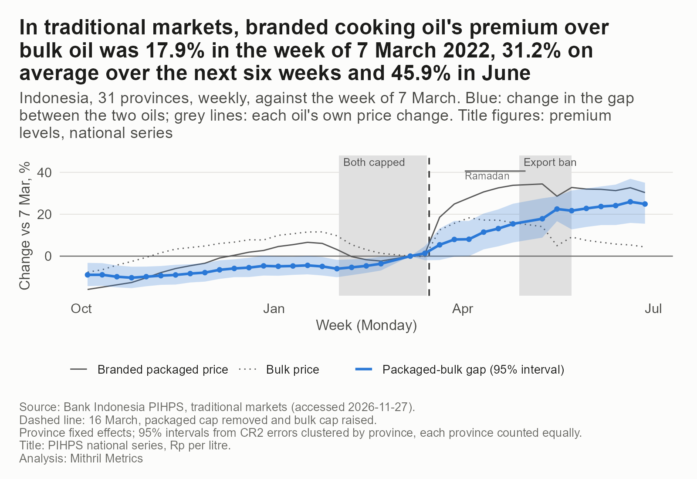
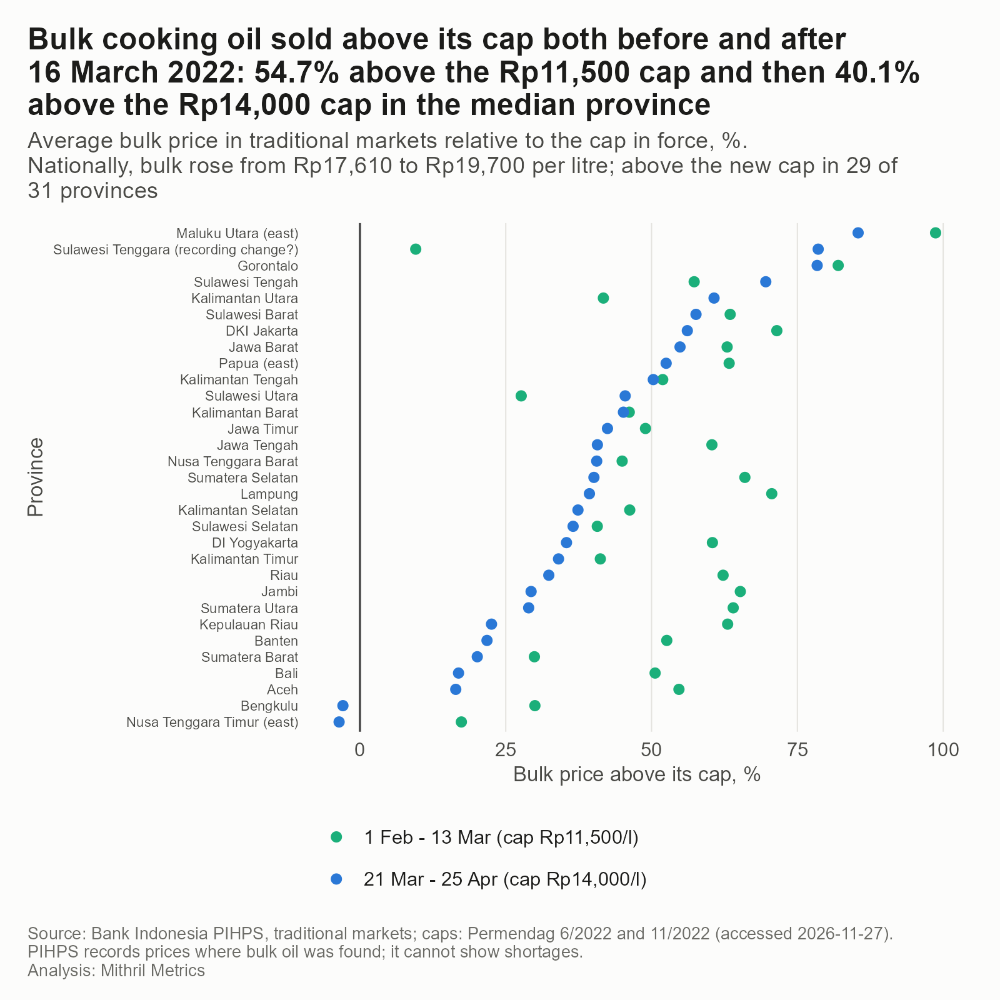
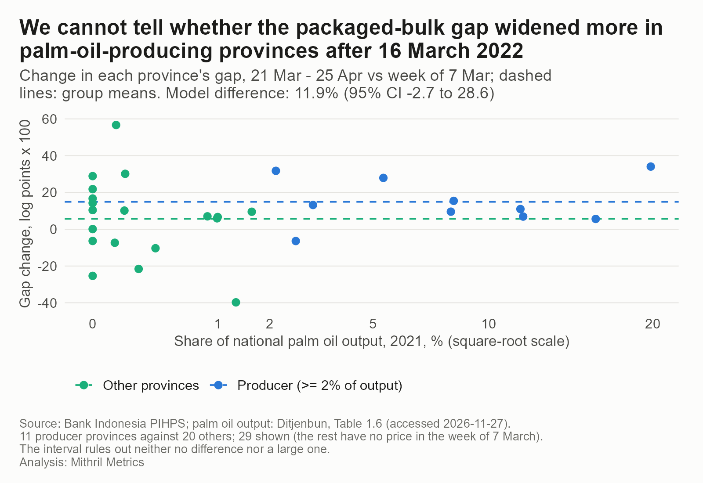

---
# ONE source file -> three outputs (07_report_and_post_templates.md):
#   (1) blog post            report.html   (format: html, sections A1-A8)
#   (2) LinkedIn post        output/linkedin_post.txt + output/linkedin_check.txt (section B)
#   (3) technical note, 2-3 pages A4, brief.pdf (format: typst, section C): the place for more detail
# Every number comes from output/key_numbers.csv through kn(); an unknown key stops the render.
title: "After Indonesia lifted its price cap on packaged cooking oil in March 2022, how far did it pull away from bulk oil?"
description: "Branded oil's premium over bulk widened far more than in any comparable period of 2017-2021, while bulk oil itself sold well above its cap."
author: "Pietro Sala"
date: "2026-11-27"
categories: ["Region: SE Asia", "Method: Event study", "Theme: Food security"]
image: output/fig1_hero.png           # listing thumbnail + open-graph image
draft: true                           # set to false to publish
title-block-banner: true
params:
  linkedin_max_chars: 1300
  linkedin_hook_max_chars: 210        # approx. text visible before "...see more" on mobile
  strict: false                       # true = stop the render if LinkedIn limits are exceeded
format:
  html:
    toc: false
    format-links: false
  typst:
    output-file: brief                # -> brief.pdf
    papersize: a4
    margin:
      x: 1.7cm
      y: 1.4cm
    fontsize: 11pt
    fig-format: png
    keep-typ: false
execute:
  echo: false
  warning: false
  message: false
---

```{r}
#| label: guard
#| include: false
# Before the analysis has been run there are no results: stop knitting here, so the
# website build on GitHub does not fail while a case is still in progress.
if (!file.exists("output/key_numbers.csv")) knitr::knit_exit("*Results pending.*")
```

```{r}
#| label: setup
#| include: false
suppressPackageStartupMessages({
  library(acutils)
  library(yaml)
})
meta    <- yaml::read_yaml("00_meta.yml", fileEncoding = "UTF-8")
kn_file <- "output/key_numbers.csv"
k <- function(key, ...) acutils::kn(key, file = kn_file, ...)   # formatted key number
kn_tbl  <- acutils::kn_read(kn_file)
`%||%` <- function(a, b) if (is.null(a) || identical(a, "")) b else a
bold_first <- function(x) unname(vapply(x, function(s) {   # PDF: bold the first sentence, or its lead clause if long
  sent <- sub("^(.+?[.:])( .*|)$", "\\1", s, perl = TRUE)
  lead <- sent
  if (length(strsplit(sent, " ")[[1]]) > 16) {
    cl <- sub("^(.+?[,;])( .*|)$", "\\1", s, perl = TRUE)
    if (cl != s) lead <- cl
  }
  paste0("**", lead, "**", substring(s, nchar(lead) + 1))
}, ""))
bullets  <- function(x) cat(paste0("- ", x), sep = "\n")
site_url <- "https://mithril-metrics.github.io"   # same for both authors
case_id  <- meta$id %||% basename(getwd())
blog_url <- meta$links$blog %||% paste0(site_url, "/cases/", case_id, "/report.html")
code_url <- meta$links$code %||% paste0("https://github.com/Mithril-Metrics/mithril-metrics.github.io/tree/main/cases/", case_id)
```

```{r}
#| label: shared-text
#| include: false
# ---------------------------------------------------------------------------------
# WRITE HERE ONCE. These strings feed the blog, the technical note (PDF) and the LinkedIn post.
# Note-only strings (more detail than the blog): method_detail, robustness, references.
pct <- function(key, ...) k(key, unit = TRUE, ...)
ci <- function(lo, hi) paste0("95% CI ", pct(lo), " to ", pct(hi))
rp <- function(key) paste0("Rp", k(key))
transfer_rp <- paste0("Rp", formatC(meta$cash_transfer$rp_month, format = "d", big.mark = ","))

# Technical note strings: written at P9
method_detail <- "P9: **one bolded sentence on what we compare.** Then *Data.*, *Model.*, *Inference.*, *Identification.* as short italic-labelled parts. 120-200 words."
results_note <- c("P9: **bolded key finding.** Then the estimate and its interval from kn().")
robustness <- c("P9: **bolded lead: what the check shows.** Then each check with its estimate and interval from kn().")

references <- c(
  "Argus Media (2022). Indonesia to remove DMO, raise CPO levy. 17 March. [argusmedia.com](https://www.argusmedia.com/en/news-and-insights/latest-market-news/2312749-indonesia-to-remove-dmo-raise-cpo-levy)",
  "Bisnis.com (2025). Harga Minyakita di 441 daerah masih mahal di atas HET Rp15.700 per liter. 30 June. [bisnis.com](https://ekonomi.bisnis.com/read/20250630/12/1889006/harga-minyakita-di-441-daerah-masih-mahal-di-atas-het-rp15700-per-liter)",
  "Buditomo, R. and Kusumaningrum, N. (2022). Indonesia reverses course on export restriction on crude palm oil products. *Global Compliance News*, 1 April. [globalcompliancenews.com](https://www.globalcompliancenews.com/2022/04/01/indonesia-reverses-course-on-export-restriction-on-crude-palm-oil-products-and-instead-imposes-higher-export-levy-to-control-the-export-of-cooking-oil-25032022/)",
  "Cabinet Secretariat of Indonesia (2022). Keterangan pers Presiden RI terkait BLT minyak goreng. 1 April. [setkab.go.id](https://setkab.go.id/keterangan-pers-presiden-ri-terkait-blt-minyak-goreng-di-istana-merdeka-1-april-2022/)",
  "Katadata (2025). Harga Minyakita melonjak, distribusi hanya lewat BUMN pangan mulai pekan depan. 18 December. [katadata.co.id](https://katadata.co.id/berita/industri/6943cb0848985/harga-minyakita-melonjak-distribusi-hanya-lewat-bumn-pangan-mulai-pekan-depan)",
  "RRI (2026). BPS: Harga Minyakita turun tapi masih di atas HET. 16 June. [rri.co.id](https://rri.co.id/nasional/2496355/bps-harga-minyakita-turun-tapi-masih-di-atas-het)"
)
# ---------------------------------------------------------------------------------
question <- meta$question

bottom_line <- paste0(
  "In Indonesia's traditional markets, branded packaged cooking oil cost ", pct("nat_gap_ref_pct"),
  " more than bulk oil in the week before its price cap was lifted on 16 March 2022, ",
  pct("nat_gap_post_preban_pct"), " more over the next six weeks and ", pct("nat_gap_post_ban_pct"),
  " more in June, a widening far larger than any comparable change in 2017-2021. ",
  "Bulk oil did not stay at its cap: in the median province it sold ", pct("bulk_excess_post_median_pct"),
  " above the new Rp14,000 per litre cap, after ", pct("bulk_excess_caps_median_pct"), " above the old one. ",
  "The data show how far prices moved, not which of the measures taken that week moved them."
)

why_now <- paste0(
  "Indonesia still caps the retail price of Minyakita, its cooking oil in simple packaging, at Rp15,700 per litre. ",
  "**In June 2025 Statistics Indonesia (BPS) found Minyakita above that cap in 441 of 493 districts.** ",
  "Since December 2025 part of its supply must go through the state food companies Bulog and ID Food, and in June 2026 ",
  "the national average was still above the cap. The clearest recent record of what happens in traditional markets when one type of cooking oil is capped ",
  "and another is not comes from March 2022, when Indonesia lifted the cap on packaged oil and kept a higher one on bulk oil."
)

method_plain <- paste0(
  "**We compare the price of branded packaged oil with the price of bulk oil in the same province and week, so that shocks ",
  "hitting both oils alike (world palm oil prices, the rupiah, local demand) cancel out, and follow how this gap moved after ",
  "16 March relative to the week of 7 March.** ",
  "We use Bank Indonesia's weekly prices from traditional markets in ", k("n_provinces"),
  " provinces, October 2021 to June 2022, per litre like the caps. ",
  "Every province switched in the same week, so to judge whether the change was unusual we compare the national monthly gap ",
  "with every change of the same length in 2017-2021. The main tests were fixed before we saw results; later checks are ",
  "labelled exploratory."
)

implications <- c(
  paste0("If a retail cap is meant to set what households pay, compliance in traditional markets comes first: in early 2022 ",
         "neither cap was met there even while both applied. A tighter cap may draw supply away from these markets ",
         "(not tested here)."),
  paste0("If a two-tier system, a capped cheap oil next to an uncapped branded one, is meant to protect lower-income buyers, ",
         "**the capped oil has to be sold near its cap**; otherwise a fixed cash transfer buys less of it than planned. ",
         "We assume, but do not observe, that bulk buyers are mostly lower-income households."),
  paste0("If the aim is to monitor the Minyakita cap today, weekly prices by province and type of oil show within weeks ",
         "how far each type sits from its cap; they cannot show shortages.")
)

caveats <- c(
  paste0("**The gap measures everything that changed on 16-20 March 2022, not the cap removal alone:** the bulk cap rose and ",
         "bulk supply was subsidised, the palm oil domestic market obligation was scrapped and the export levy raised, amid the ",
         "Ukraine-war spike in vegetable oil prices. The comparison with 2017-2021 shows the change was unusual, not what caused it."),
  paste0("The six-week figure across provinces depends on whether the February trend under the caps would have continued; ",
         "the national comparison with 2017-2021 does not."),
  "Ramadan (from early April) and the palm oil export ban (28 April to 23 May) fall inside the period after the switch.",
  paste0("Bulk oil was itself capped and often scarce, so it is not an untouched control, and PIHPS records ",
         "prices only where oil was found.")
)

caveats_note <- c(caveats,                       # technical note: the post's four first, then the rest
  "In traditional markets neither cap was met while both applied; lifting the packaged cap removed a rule these markets were not meeting.",
  "The June widening mostly reflects bulk prices easing during and after the export ban, while packaged prices stayed high.",
  "The week before the switch was already capped and short of supply; we also report the gap against the months before any cap.",
  "We assume bulk oil is mainly bought by lower-income households; we do not observe buyers and do not estimate incidence.",
  paste0("With ", k("n_producer"), " producing provinces against 20 others, the producer comparison rules out neither no difference nor a large one."),
  "Province averages count each province equally; national PIHPS figures are given alongside.",
  "Packaged prices are branded refill pouches, so they compare with the premium-packaging cap.",
  paste0("Both Sulawesi Tenggara series roughly double from March 2022, likely a recording change; results without it are similar. ",
         "Nusa Tenggara Timur's bulk price sits at Rp13,500 for months and may be a stale entry."),
  "Kepulauan Bangka Belitung, Maluku and Papua Barat have no bulk series; the weeks of 28 February and 2 May 2022 have no prices in any province.",
  "The overlapping 2017-2021 changes amount to only about 15 independent ones, and the 95% intervals show how consistently provinces moved, not uncertainty about the cause.",
  "The 2017-2021 reference includes the COVID-19 years; excluding 2020-2021 can only lower the largest reference change, so the result holds for 2017-2019 alone.",
  "PIHPS is an undocumented public interface; we publish only derived numbers."
)

findings <- c(                                   # LinkedIn arrows (P9 refines)
  paste0("Branded oil's premium over bulk: ", pct("nat_gap_ref_pct"), " in the week of 7 March 2022, ",
         pct("nat_gap_post_preban_pct"), " over the next six weeks, ", pct("nat_gap_post_ban_pct"), " in June"),
  paste0("Bulk oil sold ", pct("bulk_excess_post_median_pct"), " above its new cap in the median province"),
  paste0("Palm-oil-producing provinces: no clear difference (", ci("gamma_post_preban_lo", "gamma_post_preban_hi"), ")")
)

hero_alt <- paste0("Line chart of weekly changes against the week of 7 March 2022, October 2021 to June 2022, across ",
                   k("n_provinces"), " Indonesian provinces. The gap between branded packaged and bulk cooking oil is flat or ",
                   "slightly rising before the 16 March switch, then rises steadily to ", pct("es_post_ban_pct"), " on average in June. ",
                   "The packaged price jumps in the first week after the switch and stays high; the bulk price rises less and ",
                   "eases back from May, during the export ban.")

key_figures <- list(
  c(value = paste0(pct("nat_gap_ref_pct"), " to ", pct("nat_gap_post_preban_pct")),
    label = "Packaged premium over bulk, before and after the switch"),
  c(value = paste0(pct("drift_post_preban_pct", sign = TRUE), " to ", pct("es_post_preban_pct", sign = TRUE)),
    label = "Six-week widening across provinces"),
  c(value = pct("bulk_excess_post_median_pct"), label = "Bulk oil above its new cap, median province"),
  c(value = paste0(k("transfer_litres_actual"), " l"), label = paste0("Bulk oil the monthly cash transfer bought (", k("transfer_litres_cap"), " l at the cap)"))
)

author_slug <- gsub("[^a-z]+", "-", tolower(iconv(rmarkdown::metadata$author %||% "", to = "ASCII//TRANSLIT")))

method_tag <- "Method: within-province event study of the packaged-bulk price gap, Bank Indonesia PIHPS weekly prices, 2021-2022"
hashtags   <- "#FoodPolicy #PalmOil #Indonesia #AgriculturalEconomics"
```

::: {.content-visible when-format="html"}

::: {.bottom-line}
**Short answer.** `r bottom_line`
:::

```{r}
#| label: key-figures
#| results: asis
cat('<div class="key-figures">\n')
for (f in key_figures) {
  cat('<div class="kf"><div class="kf-value">', f[["value"]], '</div><div class="kf-label">',
      f[["label"]], '</div></div>\n', sep = "")
}
cat('</div>\n')
```

## Why this matters now

`r why_now` Sources: [Bisnis, citing BPS, June 2025](`r meta$hook$primary_source$url`); [Katadata, December 2025](`r meta$hook$second_source$url`); [RRI, June 2026](`r meta$hook$third_source$url`).

## What we did

::: {.method-note}
`r method_plain`
:::

## What the data show

### The premium widened far more than in any comparable period since 2017

{fig-alt="`r hero_alt`" width="100%"}

**Nationally, the premium of branded over bulk oil rose from `r pct("nat_gap_ref_pct")` in the week of 7 March to `r pct("nat_gap_post_preban_pct")` over the next six weeks and `r pct("nat_gap_post_ban_pct")` in June.** From February to March 2022 the national monthly gap widened by `r k("plac_h1_actual_pp")` log points; none of the `r k("plac_h1_n")` one-month changes in 2017-2021 exceeded `r k("plac_h1_max_pp")`. By June it had widened by `r k("plac_h4_actual_pp")` points, against at most `r k("plac_h4_max_pp")` for any four-month change, also when we compare only with changes that span Ramadan.

Across provinces, the gap widened by `r pct("es_post_preban_pct", sign = TRUE)` on average over the six weeks (`r ci("es_post_preban_lo", "es_post_preban_hi")`; Holm-adjusted p = `r k("es_post_preban_p_holm")`), as packaged prices rose `r pct("pkg_post_preban_pct")` and bulk prices `r pct("bulk_post_preban_pct")`. Under the caps the gap was already rising towards its 7 March level, by about `r k("cap_drift_pp_week", digits_override = 1)` points a week. **If that February trend had continued (exploratory), the six-week widening would be `r pct("drift_post_preban_pct", sign = TRUE)` (`r ci("drift_post_preban_lo", "drift_post_preban_hi")`), so we put it between `r pct("drift_post_preban_pct")` and `r pct("es_post_preban_pct")`.** By June the gap was `r pct("es_post_ban_pct", sign = TRUE)` wider (`r ci("es_post_ban_lo", "es_post_ban_hi")`), mostly because bulk prices eased back to `r pct("bulk_post_ban_pct")` above their 7 March level while packaged prices stayed `r pct("pkg_post_ban_pct")` above theirs.

### Bulk oil sold well above its cap before and after the switch

{fig-alt="Dot chart of 31 provinces showing how far the average bulk cooking oil price sat above the cap in force, before the switch (1 February to 13 March 2022, cap Rp11,500 per litre) and after it (21 March to 25 April, cap Rp14,000). Almost every province is above the cap in both periods; only Bengkulu and Nusa Tenggara Timur fall just below the new cap." width="100%"}

**In the median province bulk oil sold `r pct("bulk_excess_caps_median_pct")` above its Rp11,500 cap from 1 February to 13 March, and `r pct("bulk_excess_post_median_pct")` above the new Rp14,000 cap from 21 March to 25 April.** It was above the new cap in `r k("n_prov_bulk_above_cap_post")` of `r k("n_prov_bulk_post")` provinces, and the national average rose from `r rp("nat_bulk_caps")` to `r rp("nat_bulk_post_preban")` per litre. While both caps applied, branded packaged oil also sold `r pct("pkg1_vs_premium_cap_caps_pct")` above its own cap, so in traditional markets lifting that cap removed a rule that was not being met. The `r transfer_rp` monthly cash transfer announced on 1 April ([Setkab](https://setkab.go.id/keterangan-pers-presiden-ri-terkait-blt-minyak-goreng-di-istana-merdeka-1-april-2022/)) would have bought `r k("transfer_litres_cap")` litres of bulk oil at the cap, but `r k("transfer_litres_actual")` litres at the average price in late March and April.

### Palm-oil-producing provinces: no clear difference

{fig-alt="Scatter of 29 provinces: share of national palm oil output on the horizontal axis, change in the packaged-bulk gap after 16 March 2022 on the vertical axis. Producer provinces average a somewhat larger change than other provinces, but both groups are widely spread." width="100%"}

**In the `r k("n_producer")` provinces that each produce at least 2% of Indonesia's palm oil, the gap widened `r pct("gamma_post_preban_pct")` more over the six weeks than elsewhere, but the interval runs from `r pct("gamma_post_preban_lo")` to `r pct("gamma_post_preban_hi")` (p = `r k("gamma_post_preban_p")`).** By June the difference was `r pct("gamma_post_ban_pct", sign = TRUE)` (`r ci("gamma_post_ban_lo", "gamma_post_ban_hi")`). Before the switch the two groups moved alike (p = `r k("het_cap_joint_p")`).

## What this means for policy

```{r}
#| results: asis
bullets(implications)
```

::: {.caveats}
## Caveats

```{r}
#| results: asis
bullets(caveats)
```
:::

::: {.data-code}
## Data & code

```{r}
#| results: asis
src <- Filter(function(s) !is.null(s$name), meta$sources)
if (length(src)) {
  bullets(vapply(src, function(s) paste0(
    "**", s$name, "**", if (!is.null(s$table)) paste0(" (", s$table, ")") else "",
    if (!is.null(s$version)) paste0(", version ", s$version) else "",
    if (!is.null(s$accessed)) paste0(", accessed ", s$accessed) else "",
    if (!is.null(s$url)) paste0(". [Link](", s$url, ")") else ""), ""))
} else {
  cat("- *Fill `sources` in 00_meta.yml.*\n")
}
cat("\nCode to reproduce every number and figure: [GitHub](", code_url, "). ",
    "Technical note with more detail (PDF, 2-3 pages): [brief.pdf](brief.pdf).\n", sep = "")
```

**Use of AI tools.** We use Claude, an AI assistant by Anthropic, as a working tool: to help with coding, data retrieval scripts and first drafts of text. Questions, methods, robustness checks and conclusions are our own, every number is reproducible from the published code, and we review all text before it goes online.
:::

```{r}
#| label: post-footer
#| results: asis
photo <- file.path("..", "..", "images", "people", paste0(author_slug, ".jpg"))
cat('<div class="post-footer">',
    if (nzchar(author_slug)) paste0('') else "",
    '<p>Written by <a href="../../people/', author_slug, '.html">', rmarkdown::metadata$author,
    '</a>. Views are the authors\' own. Part of <em>Mithril Metrics</em>: reproducible analyses ',
    'of current agri-food, water and climate policy questions.</p></div>\n', sep = "")
```

:::

::: {.content-visible when-format="typst"}

<!-- TECHNICAL NOTE (2-3 pages A4, never more). The blog and LinkedIn stay concise; extra
     detail goes here: specification, identification, inference, results and robustness as short
     bullets with a bolded lead (no tables), references and data sources one per line. Same style rules: concise, every
     result from kn(), untested mechanisms labelled, one bolded key sentence per section. -->

**Question.** `r question`

**Short answer.** `r bottom_line`

**1. Data and method**

`r method_detail`

**2. Results**

{width="70%"}

```{r}
#| results: asis
bullets(results_note)
```

**3. Robustness checks**

```{r}
#| results: asis
bullets(robustness)
```

**4. What this means for policy**

```{r}
#| results: asis
bullets(bold_first(gsub("\\*\\*", "", implications)))
```

**5. Caveats**

```{r}
#| results: asis
bullets(bold_first(gsub("\\*\\*", "", caveats_note)))
```

**References**

```{r}
#| results: asis
bullets(references)
```

```{r}
#| label: brief-sources
#| include: false
src_brief <- vapply(Filter(function(s) !is.null(s$name), meta$sources), function(s)
  paste0(s$name, if (!is.null(s$accessed)) paste0(" (accessed ", s$accessed, ")") else ""), "")
if (!length(src_brief)) src_brief <- "[fill sources in 00_meta.yml]"
```

**Data and code**

```{r}
#| results: asis
bullets(c(src_brief, paste0("Code: [GitHub, Mithril-Metrics](", code_url, ")")))
```

```{=typst}
#text(size: 9pt, fill: rgb("#5b6876"))[`r rmarkdown::metadata$author` · Views are the authors' own. Mithril Metrics · mithril-metrics.github.io]
```

```{=typst}
#text(size: 8pt, fill: rgb("#5b6876"))[*Use of AI tools.* We use Claude, an AI assistant by Anthropic, as a working tool: to help with coding, data retrieval scripts and first drafts of text. Questions, methods, robustness checks and conclusions are our own, every number is reproducible from the published code, and we review all text before it goes online.]
```

:::

```{r}
#| label: linkedin
#| include: false
# Section B: LinkedIn post, built from the same strings and key numbers (P9 finalises).
hook <- paste0("When Indonesia lifted its price cap on packaged cooking oil in March 2022, branded oil's premium over bulk oil rose from ",
               pct("nat_gap_ref_pct"), " to ", pct("nat_gap_post_preban_pct"), " within six weeks.")
why_li <- "Placeholder (P9): Minyakita is still sold above its cap; 2022 is the clearest record of a two-tier cap."
impl_li <- implications[2]
li <- paste0(
  hook, "\n\n",
  why_li, "\n\n",
  "What we found:\n", paste0("→ ", findings, collapse = "\n"), "\n\n",
  "What it means: ", impl_li, "\n\n",
  method_tag, "\n",
  "Full analysis and code: link in the first comment\n\n",
  hashtags
)
dir.create("output", showWarnings = FALSE)
writeLines(li, "output/linkedin_post.txt", useBytes = TRUE)
writeLines(paste0("Full analysis and code: ", blog_url), "output/linkedin_first_comment.txt", useBytes = TRUE)
writeLines(paste("Alt text, hero figure:", hero_alt), "output/hero_alt.txt", useBytes = TRUE)

n_total <- nchar(li, type = "chars")
n_hook  <- nchar(hook, type = "chars")
checks <- c(
  sprintf("LinkedIn post: %d characters (limit %d) %s", n_total, params$linkedin_max_chars,
          if (n_total <= params$linkedin_max_chars) "OK" else "TOO LONG"),
  sprintf("Hook: %d characters (aim <= %d, approx. visible before 'see more') %s", n_hook,
          params$linkedin_hook_max_chars,
          if (n_hook <= params$linkedin_hook_max_chars) "OK" else "TOO LONG"),
  sprintf("Placeholders left: %s", if (grepl("\\[|Placeholder", li)) "YES - edit before posting" else "none")
)
writeLines(checks, "output/linkedin_check.txt")
message(paste(checks, collapse = "\n"))
too_long <- n_total > params$linkedin_max_chars || n_hook > params$linkedin_hook_max_chars
if (too_long && isTRUE(params$strict)) stop(paste(checks, collapse = "\n"))
if (too_long) warning(paste(checks, collapse = "\n"))
```
