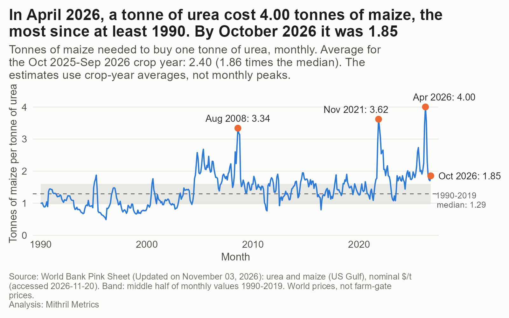

```{r}
#| label: guard
#| include: false
if (!file.exists("output/key_numbers.csv")) knitr::knit_exit("*Results pending.*")
```

```{r}
#| label: setup
#| include: false
suppressPackageStartupMessages({
  library(acutils)
  library(yaml)
})
meta    <- yaml::read_yaml("00_meta.yml", fileEncoding = "UTF-8")
kn_file <- "output/key_numbers.csv"
k <- function(key, ...) acutils::kn(key, file = kn_file, ...)
kn_tbl <- acutils::kn_read(kn_file)
val <- function(key) kn_tbl$value[kn_tbl$key == key]
pct10 <- function(b) sprintf("%.1f%%", 100 * (1.1^b - 1))   # % change for a 10% higher ratio
mt <- function(key) sprintf("%.1f", abs(val(key)) / 1e3)
`%||%` <- function(a, b) if (is.null(a) || identical(a, "")) b else a
bullets  <- function(x) cat(paste0("- ", x), sep = "\n")
site_url <- "https://mithril-metrics.github.io"   # same for both authors
case_id  <- meta$id %||% basename(getwd())
blog_url <- meta$links$blog %||% paste0(site_url, "/cases/", case_id, "/report.html")
code_url <- meta$links$code %||% paste0("https://github.com/Mithril-Metrics/mithril-metrics.github.io/tree/main/cases/", case_id)
oecd_brief_url <- meta$hook$primary_source$url
oecd_apme_url  <- meta$hook$other_sources[[1]]$url
icc_url        <- meta$hook$other_sources[[2]]$url

groups <- read.csv("output/tab_subsidy_groups.csv")
high_names <- groups$country[groups$high]
number_words <- c("One", "Two", "Three", "Four", "Five", "Six", "Seven", "Eight", "Nine", "Ten")
n_high_word <- number_words[length(high_names)]
s08 <- read.csv("output/tab_subsidy_2008.csv")
s08_up   <- s08$country[s08$share_change_pp > 0]
s08_down <- s08$country[s08$share_change_pp <= 0]
and_list <- function(x) if (length(x) < 2) x else paste(paste(x[-length(x)], collapse = ", "), "and", x[length(x)])

peak_month <- paste(month.name[val("ratio_p26_month")], val("ratio_p26_year"))
peak_08 <- paste(month.name[val("ratio_p0708_month")], val("ratio_p0708_year"))
peak_21 <- paste(month.name[val("ratio_p2122_month")], val("ratio_p2122_year"))
latest_month <- paste(month.name[val("latest_month")], val("latest_year"))
excl0 <- function(key) {                  # TRUE if the 90% interval excludes zero
  val(paste0(key, "_lo")) > 0 || val(paste0(key, "_hi")) < 0
}
lag_clear  <- excl0("b_yield_lag")
plant_clear <- excl0("b_yield_plant")
ts_clear   <- excl0("b_yield_ts")
theta_clear <- excl0("theta_yield")
b2_clear   <- excl0("theta_yield_b2")
loo_flip   <- val("loo_theta_n_excl0") > 0
n_flat     <- !excl0("b_n")
b2n_clear  <- excl0("theta_n_b2")
clear_lbl  <- function(key) if (excl0(key)) "" else ", not clear"
# Back-of-envelope with the before-planting elasticity, computed from key numbers
m_now  <- val("ratio_now_multiple")
boe_p  <- function(b) 100 * (m_now^b - 1)
boe_plant    <- boe_p(val("b_yield_plant"))
boe_plant_lo <- boe_p(val("b_yield_plant_lo"))
boe_plant_hi <- boe_p(val("b_yield_plant_hi"))
f1 <- function(x) sprintf("%.1f", abs(x))
mt_pct <- function(p) sprintf("%.1f", abs(p) / 100 * val("prod_2024_mt"))
mwi <- s08[s08$iso3 == "MWI", ]
```

```{r}
#| label: shared-text
#| include: false
question <- meta$question

bottom_line <- paste0(
  "**Maize yields in these ", k("n_countries"), " countries have been lower in years when world ",
  "fertiliser was dear relative to maize, but the link weakens once prices after planting are ",
  "left out.** A 10% higher world urea-to-maize price ratio goes with ",
  k("b_yield_10pct", abs = TRUE, unit = TRUE), " lower yields in the same season (", k("year_start"), "-",
  k("year_end"), "), ",
  if (plant_clear) paste0(k("b_yield_plant_10pct", abs = TRUE, unit = TRUE), " lower with the ratio before planting")
  else "no clear change with the ratio before planting",
  if (lag_clear) paste0(" and ", k("b_yield_lag_10pct", abs = TRUE, unit = TRUE), " with the previous year's ratio. ")
  else " and no clear change with the previous year's ratio. ",
  "We read this as the ratio tracking world market conditions at least as much as fertiliser costs. ",
  "In high-subsidy countries, recorded nitrogen use did not fall in high-price years",
  if (!b2n_clear) ", but this does not hold on 2005-2024 alone" else "",
  ", and harvests show no consistent difference between the groups."
)

key_figures <- list(
  c(value = k("ratio_p26"),
    label = paste0("Tonnes of maize needed to buy a tonne of urea in ", peak_month, ", the most since at least 1990")),
  c(value = k("b_yield_10pct", unit = TRUE),
    label = paste0("Maize yield when the world urea-to-maize ratio is 10% higher, same crop year (association; ",
                   k("b_yield_plant_10pct", unit = TRUE), " with the ratio before planting)")),
  c(value = k("b_n_10pct", unit = TRUE),
    label = paste0("Nitrogen use per hectare when the ratio is 10% higher, all countries", clear_lbl("b_n")))
)

why_now <- paste0(
  "Fertiliser prices jumped after the Strait of Hormuz, a key route for fertiliser trade, closed on ",
  "28 February 2026. The OECD's October policy brief and its Agricultural Policy Monitoring and ",
  "Evaluation 2026 (2 November) examine how fertiliser shocks reach food security, but their support ",
  "estimates cover only one Sub-Saharan African country, South Africa. We ask, for ", k("n_countries"),
  " maize-growing countries in the region: how much smaller are harvests when fertiliser is dear ",
  "relative to maize, and do input subsidies change that?"
)

method_plain <- paste0(
  "We convert the World Bank's monthly world prices of urea and maize into one ratio per crop year ",
  "(October to September): the tonnes of maize that buy a tonne of urea. We relate it to FAOSTAT maize ",
  "yields and nitrogen use per hectare in ", k("n_countries"), " countries, ", k("year_start"), "-",
  k("year_end"), " (", k("n_obs_yield"), " country-years), comparing each country with its own trend and ",
  "allowing for El Niño. The ratio is a single world series, so the estimate rests on ",
  k("n_years_ratio"), " crop years, not on every country-year. Countries are split at the median of FAO ",
  "MAFAP spending on variable inputs as a share of all public support to agriculture. Intervals are 90% ",
  "and allow for shocks shared across countries in the same year."
)

findings <- c(
  paste0("Years with a 10% higher urea-to-maize ratio have had ", k("b_yield_10pct", abs = TRUE, unit = TRUE),
         " lower maize yields in the same season (", k("b_yield_plant_10pct", unit = TRUE),
         " with the ratio before planting)"),
  paste0("The link weakens once prices after planting are left out (previous year's ratio: ",
         k("b_yield_lag_10pct", unit = TRUE), clear_lbl("b_yield_lag"), "), so we read it as world market ",
         "conditions as much as fertiliser costs"),
  paste0("High-subsidy countries: recorded nitrogen use did not fall in high-price years",
         if (!b2n_clear) " (not on 2005-2024 alone)" else "", "; no consistent yield difference")
)

implications <- c(
  paste0("If the aim is to judge exposure to the 2026 spike, the world ratio is a rough signal only. ",
         "Farm-gate prices can diverge from world prices and were not used here; national price monitoring ",
         "(FAO GIEWS for maize, AfricaFertilizer.org for fertiliser) is the closer signal."),
  paste0("If input subsidies are meant to keep fertiliser flowing during spikes, recorded nitrogen use in ",
         "high-subsidy countries held up over 1990-2024",
         if (!b2n_clear) ", though not on 2005-2024 alone" else "", ". This may partly reflect programmes scaled up during spikes, which ",
         "we did not test; for scale, Malawi's variable-input spending went from ", round(mwi$share_2007), "% to ",
         round(mwi$share_2009), "% of all public support to agriculture between the 2007 and 2009 budget years (",
         sprintf("%+.0f%%", mwi$real_change_pct), " in real terms). If the aim is to protect harvests, these data ",
         "show no consistent yield difference. The trade-off is the budget share such programmes take against a ",
         "yield gain the data cannot confirm."),
  paste0("If the aim is to plan food needs, the scale check is a guide for seasons planted at ",
         "2026 prices, not an estimate of 2026 losses: most southern African 2026 harvests were planted ",
         "before the spike.")
)

caveats <- c(
  paste0("Associations, not effects. The ratio is one world series, and high-ratio years can differ in ",
         "other ways (energy, freight, the dollar). Prices are US Gulf maize and Middle East urea; farm-gate ",
         "ratios, which in landlocked countries can differ widely, are not observed."),
  paste0("The nitrogen data cannot settle why yields fall. Nitrogen is national use on all crops per ",
         "hectare of cropland, ", k("n_imputed_pct", unit = TRUE), " of the figures are FAO estimates, and on ",
         "official figures alone nitrogen use rises with the ratio (", k("b_n_official_10pct", unit = TRUE, sign = TRUE),
         "). The timing pattern, not the nitrogen result, is our main reason to doubt a pure fertiliser-cost channel."),
  paste0("The subsidy comparison is indicative only. Groups are fixed over time, based on MAFAP spending ",
         "from 2004 (Ghana from 2016), and applied to earlier years; the median split separates countries ",
         "with similar shares (Ghana and Benin). MAFAP counts only on-budget spending, and its variable-input ",
         "category also covers seed, energy and credit. El Niño is measured in December-February, which fits ",
         "southern Africa's season better than West Africa's. With one world price series and about 20 checks ",
         "at 90%, results whose intervals barely exclude zero are suggestive; checks added after the first ",
         "results are labelled as such. The headline estimate is the one we planned.")
)

method_tag <- paste0("Method: country trends and fixed effects, ", k("n_countries"), " countries, ",
                     k("year_start"), "-", k("year_end"), "; World Bank Pink Sheet, FAOSTAT, FAO MAFAP")
hashtags <- "#FoodSecurity #Fertiliser #AgriculturalEconomics #Africa"

# ---- Technical note (PDF) only: more detail than the blog ----
rng <- function(lo, hi, ...) paste0(k(lo, ...), " to ", k(hi, ...))
row10 <- function(key) c(k(paste0(key, "_10pct"), unit = TRUE, sign = TRUE),
                         rng(paste0(key, "_10pct_lo"), paste0(key, "_10pct_hi"), unit = TRUE, sign = TRUE))
method_detail <- paste0(
  "*Data.* World Bank Pink Sheet monthly prices of urea (Middle East) and maize (US Gulf), averaged ",
  "into one ratio per crop year (October to September); FAOSTAT maize yield (QCL) and nitrogen use per ",
  "hectare of cropland (RFN) for ", k("n_countries"), " Sub-Saharan African countries, ", k("year_start"), "-",
  k("year_end"), " (", k("n_obs_yield"), " country-years for yield, ", k("n_obs_n"), " for nitrogen); NOAA's ",
  "December-February ONI; FAO MAFAP public expenditure. *Planned model (A).* Log yield, or log nitrogen ",
  "use, on the log ratio and the ONI, with country fixed effects and country-specific linear trends; the ",
  "coefficient is an elasticity, reported as the % change for a 10% higher ratio. *Subsidy comparison (B).* ",
  "The log ratio interacted with a high-subsidy indicator, with country and year fixed effects, so the ",
  "difference between groups is identified net of everything common to all countries in a year; groups are a ",
  "median split of MAFAP variable-input spending as a share of all public support to agriculture. ",
  "*Inference.* Driscoll-Kraay standard errors, robust to correlation across countries within a year and ",
  "over time; 90% intervals. Because the ratio is one world series, the effective sample is ",
  k("n_years_ratio"), " crop years; a regression of the yearly cross-country averages with Newey-West ",
  "errors and t critical values checks this. *Identification.* None for a causal effect: high-ratio years ",
  "can differ in other ways, so all estimates are associations."
)
note_tbl <- data.frame(
  Estimate = c("Yield, ratio in the same crop year (headline)",
               "Yield, ratio in the six months before planting",
               "Yield, previous crop year's ratio",
               "Yield, 35 yearly means (Newey-West, t values)",
               "Nitrogen use per ha, all countries",
               "Nitrogen use per ha, official figures only",
               "Yield, high minus low subsidy (B)",
               "Yield, high minus low, group trends, 2005-2024",
               "Nitrogen, high minus low subsidy (B)",
               "Nitrogen, high minus low, group trends, 2005-2024"),
  rbind(row10("b_yield"), row10("b_yield_plant"), row10("b_yield_lag"), row10("b_yield_ts"),
        row10("b_n"), row10("b_n_official"), row10("theta_yield"), row10("theta_yield_b2"),
        row10("theta_n"), row10("theta_n_b2")),
  Type = c("planned", "added", "planned", "added", "planned", "planned", "planned", "added", "planned", "added"),
  check.names = FALSE
)
names(note_tbl)[2:3] <- c("% for a 10% higher ratio", "90% interval")
note_caption <- paste0(
  "**The headline association is the planned same-season estimate; the link weakens once prices after ",
  "planting are left out, and the subsidy yield comparison changes sign across specifications.** ",
  "'Added' marks checks run after the first results. The figure shows model A by subsidy group."
)
robustness <- c(
  paste0("Headline yield elasticity, planned checks: leaving out one country at a time gives ",
         pct10(val("loo_yield_min")), " to ", pct10(val("loo_yield_max")), " for a 10% higher ratio. ",
         "Added: without the 2008-09 crop years ", k("b_yield_no0809_10pct", unit = TRUE), ", without 2021-22 ",
         k("b_yield_no2122_10pct", unit = TRUE), ", in the ", k("n_obs_offn"), " country-years with official ",
         "nitrogen figures ", k("b_yield_offn_10pct", unit = TRUE), ", without Zimbabwe 2000-09 ",
         k("b_yield_nozwe_10pct", unit = TRUE), "."),
  paste0("Prices entered separately (added diagnostic): ", k("b_urea_yield_10pct", unit = TRUE),
         " for a 10% higher urea price and ", k("b_maize_yield_10pct", unit = TRUE, sign = TRUE),
         " for a 10% higher maize price. Equal and opposite effects are what the ratio assumes, so this ",
         "does not separate a fertiliser channel from market conditions; it uses log average prices and ",
         "does not decompose the ratio exactly."),
  paste0("Subsidy yield difference (planned B): ", k("theta_yield_10pct", unit = TRUE, sign = TRUE),
         ". Leave-one-out, most extreme run, dropping ",
         if (val("loo_theta_max_is_zwe") == 1) "Zimbabwe entirely" else "one country", ": ",
         k("loo_theta_max_10pct", unit = TRUE, sign = TRUE), " (",
         rng("loo_theta_max_10pct_lo", "loo_theta_max_10pct_hi", unit = TRUE, sign = TRUE),
         "); dropping only Zimbabwe 2000-09 (added): ", k("theta_yield_nozwe_10pct", unit = TRUE, sign = TRUE),
         " (", rng("theta_yield_nozwe_10pct_lo", "theta_yield_nozwe_10pct_hi", unit = TRUE, sign = TRUE), "). ",
         "The group-trend model on 2005-2024 has 20 years and Driscoll-Kraay errors; its narrow interval ",
         "should be read with care."),
  paste0("Scale check: at the 2026 crop-year ratio (", k("ratio_now"), ", ", k("ratio_now_multiple"),
         " times the 1990-2019 median), yields ", f1(boe_plant), "% (before-planting estimate) to ",
         k("boe_yield_pct", abs = TRUE, unit = TRUE), " (same season) below a median year, about ",
         mt_pct(boe_plant), " to ", mt("boe_kt"), " million t of maize on 2024 output; constant elasticity, ",
         "coefficient uncertainty only.")
)
references <- paste0(
  "OECD (2026), fertiliser market disruptions and food security policy brief; OECD (2026), Agricultural ",
  "Policy Monitoring and Evaluation 2026; ICC (2026) on the Strait of Hormuz closure; World Bank ",
  "Commodity Price Data (Pink Sheet); FAOSTAT QCL and RFN; FAO MAFAP public expenditure database."
)

author_slug <- gsub("[^a-z]+", "-", tolower(iconv(rmarkdown::metadata$author %||% "", to = "ASCII//TRANSLIT")))
```

::: {.content-visible when-format="html"}

::: {.bottom-line}
**Short answer.** `r bottom_line`
:::

```{r}
#| label: key-figures
#| results: asis
cat('<div class="key-figures">\n')
for (f in key_figures) {
  cat('<div class="kf"><div class="kf-value">', f[["value"]], '</div><div class="kf-label">',
      f[["label"]], '</div></div>\n', sep = "")
}
cat('</div>\n')
```

## Why this matters now

`r why_now` Sources: [OECD fertiliser brief](`r oecd_brief_url`),
[OECD Agricultural Policy Monitoring and Evaluation 2026](`r oecd_apme_url`) and
[ICC on the Hormuz closure](`r icc_url`).

## What we did

::: {.method-note}
`r method_plain`
:::

## What the data show

### Fertiliser has not cost this much maize since at least 1990

{fig-alt="Line chart of the monthly world urea-to-maize price ratio, 1990 to `r latest_month`. It peaked at `r k("ratio_p0708")` in `r peak_08`, `r k("ratio_p2122")` in `r peak_21` and `r k("ratio_p26")` in `r peak_month`, against a 1990-2019 median of `r k("ratio_base")`, and stood at `r k("ratio_latest")` in `r latest_month`." width="100%"}

**In `r peak_month` a tonne of urea cost `r k("ratio_p26")` tonnes of maize on world markets, the
most since at least 1990.** The 1990-2019 median was `r k("ratio_base")`; earlier spikes reached
`r k("ratio_p0708")` (`r peak_08`) and `r k("ratio_p2122")` (`r peak_21`). The average for the
October 2025-September 2026 crop year was `r k("ratio_now")`, `r k("ratio_now_multiple")` times the
median. By `r latest_month` the ratio was `r k("ratio_latest")`.

### Yields are lower when the ratio is high

{fig-alt="Dot chart with 90% intervals. A 10% higher urea-to-maize ratio goes with `r k("b_yield_10pct", unit = TRUE)` maize yields across `r k("n_countries")` countries, `r k("b_yield_low_10pct", unit = TRUE)` in low-subsidy and `r k("b_yield_high_10pct", unit = TRUE)` in high-subsidy countries. Nitrogen use changes by `r k("b_n_10pct", unit = TRUE)` overall, `r k("b_n_low_10pct", unit = TRUE)` in low-subsidy and `r k("b_n_high_10pct", unit = TRUE, sign = TRUE)` in high-subsidy countries." width="100%"}

**A 10% higher ratio goes with `r k("b_yield_10pct", abs = TRUE, unit = TRUE)` lower maize yields
in the same crop year** (90% interval `r k("b_yield_10pct_lo", unit = TRUE)` to
`r k("b_yield_10pct_hi", unit = TRUE)`). Leaving out one country at a time gives
`r pct10(val("loo_yield_min"))` to `r pct10(val("loo_yield_max"))`; without the 2008-09 crop years
it is `r k("b_yield_no0809_10pct", unit = TRUE)`, without 2021-22 `r k("b_yield_no2122_10pct", unit = TRUE)`,
and without Zimbabwe's 2000-09 collapse `r k("b_yield_nozwe_10pct", unit = TRUE)`. A regression on the
`r k("n_years_ts")` yearly averages gives `r k("b_yield_ts_10pct", unit = TRUE)` (interval
`r k("b_yield_ts_10pct_lo", unit = TRUE)` to `r k("b_yield_ts_10pct_hi", unit = TRUE)`).

### The link weakens once prices after planting are left out

**The link is strongest when the ratio includes months after planting:**
`r k("b_yield_10pct", unit = TRUE)` in the same crop year, which includes months after planting,
`r k("b_yield_plant_10pct", unit = TRUE)` with the ratio in the six months before each region's
main planting (interval `r k("b_yield_plant_10pct_lo", unit = TRUE)` to
`r k("b_yield_plant_10pct_hi", unit = TRUE)`; added after the first results), and
`r k("b_yield_lag_10pct", unit = TRUE)` with the previous crop year's ratio`r clear_lbl("b_yield_lag")`.
If fertiliser costs drove the link, the before-planting ratio should matter most. We read the pattern
as the ratio tracking world market conditions at least as much as fertiliser costs; which conditions,
we do not test.

Nitrogen data do not settle this. Measured nitrogen use per hectare does not fall when the ratio is
high (`r k("b_n_10pct", unit = TRUE)`, interval `r k("b_n_10pct_lo", unit = TRUE)` to
`r k("b_n_10pct_hi", unit = TRUE, sign = TRUE)`), but `r k("n_imputed_pct", unit = TRUE)` of the
figures are FAO estimates, and in the `r k("n_obs_offn")` country-years with official figures
nitrogen use rises (`r k("b_n_official_10pct", unit = TRUE, sign = TRUE)`) while yields fall
(`r k("b_yield_offn_10pct", unit = TRUE)`).

### Input subsidies: nitrogen use held up, no consistent yield difference

`r n_high_word` countries (`r and_list(high_names)`) spend on average
`r k("b1_share_high", unit = TRUE)` of public support to agriculture on input subsidies, against
`r k("b1_share_low", unit = TRUE)` in the other `r tolower(number_words[sum(!groups$high)])`. When the
ratio is 10% higher, nitrogen use falls `r k("b_n_low_10pct", abs = TRUE, unit = TRUE)` in the
low-subsidy group and rises `r k("b_n_high_10pct", unit = TRUE)` in the high-subsidy group. The gap is
`r if (excl0("theta_n")) "clear" else "not clear"` with year effects
(`r k("theta_n_10pct", unit = TRUE, sign = TRUE)`, interval `r k("theta_n_10pct_lo", unit = TRUE, sign = TRUE)`
to `r k("theta_n_10pct_hi", unit = TRUE, sign = TRUE)`) but `r if (b2n_clear) "also holds" else "does not hold"`
on 2005-2024 with each group's own trends and El Niño term
(`r k("theta_n_b2_10pct", unit = TRUE, sign = TRUE)`, interval `r k("theta_n_b2_10pct_lo", unit = TRUE, sign = TRUE)`
to `r k("theta_n_b2_10pct_hi", unit = TRUE, sign = TRUE)`). One possible explanation, untested here, is that programmes procured more in spike years.

**`r if (!theta_clear) "The planned comparison shows no clear yield difference between the groups" else "The planned comparison shows a yield difference between the groups"`**
(`r k("theta_yield_10pct", unit = TRUE, sign = TRUE)` for a 10% higher ratio, interval
`r k("theta_yield_10pct_lo", unit = TRUE, sign = TRUE)` to `r k("theta_yield_10pct_hi", unit = TRUE, sign = TRUE)`).
Checks added after the first results give clear differences of opposite sign: `r k("theta_yield_b2_10pct", unit = TRUE, sign = TRUE)`
(interval `r k("theta_yield_b2_10pct_lo", unit = TRUE, sign = TRUE)` to
`r k("theta_yield_b2_10pct_hi", unit = TRUE, sign = TRUE)`) with each group's own trends on 2005-2024,
and `r k("loo_theta_max_10pct", unit = TRUE, sign = TRUE)` (interval
`r k("loo_theta_max_10pct_lo", unit = TRUE, sign = TRUE)` to `r k("loo_theta_max_10pct_hi", unit = TRUE, sign = TRUE)`)
after dropping `r if (val("loo_theta_max_is_zwe") == 1) "Zimbabwe entirely" else "the most influential country"`,
the most extreme of `r k("n_countries")` leave-one-out runs (dropping only Zimbabwe 2000-09:
`r k("theta_yield_nozwe_10pct", unit = TRUE, sign = TRUE)``r clear_lbl("theta_yield_nozwe")`). **The sign
flips across specifications, so the data do not show whether subsidies protect harvests.**

### Scale check: the 2026 crop year

**Not a forecast.** If yields respond as in the past, a crop year at the
`r k("crop_year_now")` ratio (`r k("ratio_now")`) implies maize yields `r f1(boe_plant)`% (with the
before-planting estimate; interval `r f1(boe_plant_hi)`% to `r f1(boe_plant_lo)`%) to
`r k("boe_yield_pct", abs = TRUE, unit = TRUE)` (same-season estimate; interval
`r k("boe_yield_pct_hi", abs = TRUE, unit = TRUE)` to `r k("boe_yield_pct_lo", abs = TRUE, unit = TRUE)`)
below a year at the 1990-2019 median ratio: roughly `r mt_pct(boe_plant)` to `r mt("boe_kt")` million
tonnes on the `r k("prod_2024_mt", unit = TRUE)` harvested in 2024. This assumes the same response at
every price level, uses the crop-year average rather than the monthly peak, and rests largely on two
price spikes; the before-planting estimate was added after the first results. Given the timing pattern, it measures exposure to world market conditions, not to
fertiliser costs alone. Most southern African 2026 harvests were planted before the spike, and
FAOSTAT has no maize data for 2025 or 2026 yet. The `r latest_month` ratio (`r k("ratio_latest")`) is
much closer to normal, so this is not a projection for 2026/27.

## What this means for policy

```{r}
#| results: asis
bullets(implications)
```

::: {.caveats}
## Caveats

```{r}
#| results: asis
bullets(caveats)
```
:::

::: {.data-code}
## Data & code

```{r}
#| results: asis
src <- Filter(function(s) !is.null(s$name), meta$sources)
bullets(vapply(src, function(s) paste0(
  "**", s$name, "**", if (!is.null(s$table)) paste0(" (", s$table, ")") else "",
  if (!is.null(s$version)) paste0(", version ", s$version) else "",
  if (!is.null(s$accessed)) paste0(", accessed ", s$accessed) else "",
  if (!is.null(s$url)) paste0(". [Link](", s$url, ")") else ""), ""))
cat("\nChecks added after the first results (price split, Zimbabwe, spike years, official nitrogen ",
    "data, 2008 subsidy spending) are listed in `00_meta.yml`. Code to reproduce every number and ",
    "figure: [GitHub](", code_url, "). Technical note with more detail (PDF, 2-3 pages): [brief.pdf](brief.pdf).\n", sep = "")
```

**Use of AI tools.** We use Claude, an AI assistant by Anthropic, as a working tool: to help with coding, data retrieval scripts and first drafts of text. Questions, methods, robustness checks and conclusions are our own, every number is reproducible from the published code, and we review all text before it goes online.
:::

```{r}
#| label: post-footer
#| results: asis
photo <- file.path("..", "..", "images", "people", paste0(author_slug, ".jpg"))
cat('<div class="post-footer">',
    if (nzchar(author_slug)) paste0('') else "",
    '<p>Written by <a href="../../people/', author_slug, '.html">', rmarkdown::metadata$author,
    '</a>. Views are the authors\' own. Part of <em>Mithril Metrics</em>: short, reproducible analyses ',
    'of current agri-food, water and climate policy questions.</p></div>\n', sep = "")
```

:::

::: {.content-visible when-format="typst"}

**Question.** `r question`

**Short answer.** `r bottom_line`

**1. Data and method**

`r method_detail`

**2. Results**

{width="70%"}

```{r}
#| label: note-table
#| results: asis
if (exists("note_tbl")) print(knitr::kable(note_tbl, format = "pipe", row.names = FALSE))
```

`r note_caption`

**3. Robustness and exploratory checks**

```{r}
#| results: asis
bullets(robustness)
```

**4. What this means for policy**

```{r}
#| results: asis
bullets(implications)
```

**5. Caveats**

```{r}
#| results: asis
bullets(caveats)
```

**References.** `r references`

```{r}
#| label: brief-sources
#| include: false
src_brief <- vapply(Filter(function(s) !is.null(s$name), meta$sources), function(s)
  paste0(s$name, if (!is.null(s$accessed)) paste0(" (accessed ", s$accessed, ")") else ""), "")
src_brief <- paste(src_brief, collapse = "; ")
```

**Data & code.** `r src_brief`. Code: [GitHub, Mithril-Metrics](`r code_url`).

```{=typst}
#text(size: 9pt, fill: rgb("#5b6876"))[`r rmarkdown::metadata$author` · Views are the authors' own. Mithril Metrics · mithril-metrics.github.io]
```

```{=typst}
#text(size: 8pt, fill: rgb("#5b6876"))[*Use of AI tools.* We use Claude, an AI assistant by Anthropic, as a working tool: to help with coding, data retrieval scripts and first drafts of text. Questions, methods, robustness checks and conclusions are our own, every number is reproducible from the published code, and we review all text before it goes online.]
```

:::

```{r}
#| label: linkedin
#| include: false
# Draft only: finalised at the LinkedIn stage (P9)
hook <- paste0("In ", peak_month, " a tonne of urea cost ", k("ratio_p26"), " tonnes of maize on ",
               "world markets, the most since at least 1990. What does that mean for harvests in Africa?")
li_why <- paste0("The OECD's new fertiliser work covers only one Sub-Saharan African country. ",
                 "We looked at ", k("n_countries"), " maize-growing countries since ", k("year_start"), ".")
li <- paste0(
  hook, "\n\n",
  li_why, "\n\n",
  "What we found:\n", paste0("→ ", findings, collapse = "\n"), "\n\n",
  "What it means: the world ratio is a rough signal, not a forecast. World prices only; farm-gate ",
  "ratios differ widely and were not used. These data cannot confirm that input subsidies protect harvests.\n\n",
  method_tag, "\n",
  "Full analysis and code: link in the first comment\n\n",
  hashtags
)
dir.create("output", showWarnings = FALSE)
writeLines(li, "output/linkedin_post.txt", useBytes = TRUE)
writeLines(paste0("Full analysis and code: ", blog_url), "output/linkedin_first_comment.txt", useBytes = TRUE)

n_total <- nchar(li, type = "chars")
n_hook  <- nchar(hook, type = "chars")
checks <- c(
  sprintf("LinkedIn post: %d characters (limit %d) %s", n_total, params$linkedin_max_chars,
          if (n_total <= params$linkedin_max_chars) "OK" else "TOO LONG"),
  sprintf("Hook: %d characters (aim <= %d) %s", n_hook, params$linkedin_hook_max_chars,
          if (n_hook <= params$linkedin_hook_max_chars) "OK" else "TOO LONG"),
  sprintf("Placeholders left: %s", if (grepl("\\[|Placeholder", li)) "YES - edit before posting" else "none")
)
writeLines(checks, "output/linkedin_check.txt")
message(paste(checks, collapse = "\n"))
too_long <- n_total > params$linkedin_max_chars || n_hook > params$linkedin_hook_max_chars
if (too_long && isTRUE(params$strict)) stop(paste(checks, collapse = "\n"))
if (too_long) warning(paste(checks, collapse = "\n"))
```
