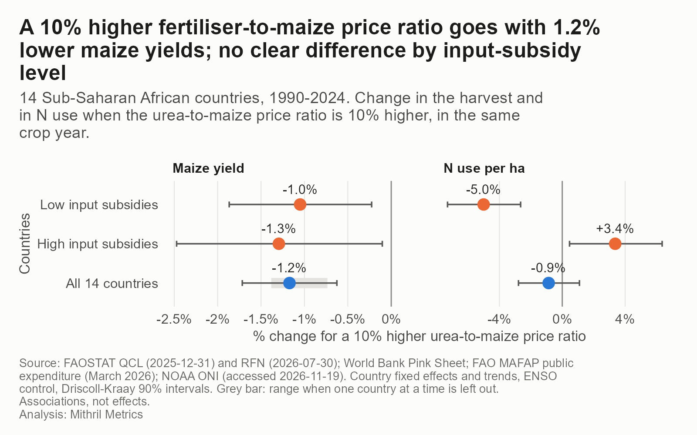

```{r}
#| label: guard
#| include: false
if (!file.exists("output/key_numbers.csv")) knitr::knit_exit("*Results pending.*")
```

```{r}
#| label: setup
#| include: false
suppressPackageStartupMessages({
  library(acutils)
  library(yaml)
})
meta    <- yaml::read_yaml("00_meta.yml", fileEncoding = "UTF-8")
kn_file <- "output/key_numbers.csv"
k <- function(key, ...) acutils::kn(key, file = kn_file, ...)
kn_tbl <- acutils::kn_read(kn_file)
val <- function(key) kn_tbl$value[kn_tbl$key == key]
pct10 <- function(b) sprintf("%.1f%%", 100 * (1.1^b - 1))   # % change for a 10% higher ratio
mt <- function(key) sprintf("%.1f", abs(val(key)) / 1e3)
`%||%` <- function(a, b) if (is.null(a) || identical(a, "")) b else a
bullets  <- function(x) cat(paste0("- ", x), sep = "\n")
blog_url <- meta$links$blog %||% "[blog link]"
code_url <- meta$links$code %||% "[GitHub link]"
oecd_brief_url <- meta$hook$primary_source$url
oecd_apme_url  <- meta$hook$other_sources[[1]]$url
icc_url        <- meta$hook$other_sources[[2]]$url

groups <- read.csv("output/tab_subsidy_groups.csv")
high_names <- groups$country[groups$high]
number_words <- c("One", "Two", "Three", "Four", "Five", "Six", "Seven", "Eight", "Nine", "Ten")
n_high_word <- number_words[length(high_names)]
s08 <- read.csv("output/tab_subsidy_2008.csv")
s08_up   <- s08$country[s08$share_change_pp > 0]
s08_down <- s08$country[s08$share_change_pp <= 0]
and_list <- function(x) if (length(x) < 2) x else paste(paste(x[-length(x)], collapse = ", "), "and", x[length(x)])

peak_month <- paste(month.name[val("ratio_p26_month")], val("ratio_p26_year"))
peak_08 <- paste(month.name[val("ratio_p0708_month")], val("ratio_p0708_year"))
peak_21 <- paste(month.name[val("ratio_p2122_month")], val("ratio_p2122_year"))
latest_month <- paste(month.name[val("latest_month")], val("latest_year"))
boe_range <- paste0(k("boe_yield_pct_nozwe", abs = TRUE, digits_override = 0), "-",
                    k("boe_yield_pct", abs = TRUE, digits_override = 0), "%")
boe_band <- paste0(k("boe_yield_pct_nozwe_hi", abs = TRUE, digits_override = 0), "-",
                   k("boe_yield_pct_lo", abs = TRUE, digits_override = 0), "%")
```

```{r}
#| label: shared-text
#| include: false
question <- meta$question

bottom_line <- paste0(
  "In the data, yes. Across ", k("n_countries"), " Sub-Saharan African countries from ",
  k("year_start"), " to ", k("year_end"), ", a 10% higher urea-to-maize price ratio goes with ",
  k("b_yield_10pct", abs = TRUE, unit = TRUE), " lower maize yields in the same season. ",
  "At the 2026 ratio, that points to yields roughly ", boe_range, " below a year with typical prices. ",
  "Countries with large input-subsidy budgets kept fertiliser use from falling, but we find no clear ",
  "sign that their harvests held up better."
)

key_figures <- list(
  c(value = k("ratio_p26"),
    label = paste0("Tonnes of maize needed to buy a tonne of urea in ", peak_month, ", the most since at least 1990")),
  c(value = k("b_yield_10pct", unit = TRUE),
    label = "Maize yield when the urea-to-maize price ratio is 10% higher, same crop year"),
  c(value = paste0("-", k("boe_yield_pct_nozwe", abs = TRUE, digits_override = 0), " to -",
                   k("boe_yield_pct", abs = TRUE, digits_override = 0), "%"),
    label = "Maize yields implied by the 2026 price ratio, against a year with typical prices, if past responses hold")
)

why_now <- paste0(
  "Fertiliser prices jumped after the Strait of Hormuz, a key route for fertiliser trade, closed on ",
  "28 February 2026. In October the OECD published a policy brief on how ",
  "fertiliser market disruptions turn into food security problems, and its Agricultural Policy ",
  "Monitoring and Evaluation 2026 report (2 November) uses support estimates to look at how ",
  "governments responded to past fertiliser price rises. Those estimates cover only one ",
  "Sub-Saharan African country, South Africa. For the region's other maize-growing countries, the ",
  "question is simpler and still open: when fertiliser gets expensive relative to the crop, how ",
  "much smaller is the harvest, and do input subsidies change that?"
)

method_plain <- paste0(
  "We take the World Bank's monthly world prices of urea and maize and turn them into one number per ",
  "crop year (October to September): the tonnes of maize a farmer would need to sell to buy a tonne ",
  "of urea. We link it to FAOSTAT maize yields and nitrogen use per hectare in ", k("n_countries"),
  " countries, ", k("year_start"), " to ", k("year_end"), " (", k("n_obs_yield"), " country-years). ",
  "Each country is compared with its own trend, so the estimate asks how far yields moved from that ",
  "trend in years when fertiliser was dear, after allowing for El Niño. Countries are split into high ",
  "and low input-subsidy groups using FAO MAFAP data on public spending on seeds, fertiliser and other ",
  "variable inputs as a share of all support to food and agriculture. Intervals are 90% and allow for ",
  "shocks shared across countries in the same year."
)

findings <- c(
  paste0("In ", peak_month, " a tonne of urea cost ", k("ratio_p26"), " tonnes of maize, the most since at least 1990"),
  paste0("A 10% higher urea-to-maize ratio goes with ", k("b_yield_10pct", abs = TRUE, unit = TRUE),
         " lower maize yields across ", k("n_countries"), " countries"),
  paste0("Where input subsidies are large, fertiliser use did not fall when prices rose (",
         k("b_n_high_10pct", unit = TRUE, sign = TRUE), " vs ", k("b_n_low_10pct", unit = TRUE),
         "), but yields fell about as much")
)

implications <- c(
  paste0("If the aim is early warning, the world urea-to-maize ratio is published monthly and, in ",
         "these data, moves with national maize yields in the same season. It signals pressure on ",
         "harvests, not where the losses fall, and it does not replace crop monitoring."),
  paste0("If input subsidies are meant to keep fertiliser flowing during price spikes, the countries ",
         "spending most on them did keep nitrogen use from falling. If the aim is to protect harvests, ",
         "we see no clear yield difference between the two groups. The trade-off is the fiscal ",
         "cost of scaling up during a spike, against a yield gain these data cannot confirm."),
  paste0("If the aim is to plan for 2026/27 food needs, our benchmark of roughly ", boe_range, " lower ",
         "yields (about ", boe_band, ") is a starting range, not a forecast. It averages past ",
         "responses, uses world rather than farm-gate prices and leaves out the El Niño now under way.")
)

caveats <- c(
  paste0("These are associations, not effects. The price ratio is one world series, so years when ",
         "fertiliser was dear can differ in other ways, and urea prices move with energy and freight ",
         "costs. The estimate covers that whole cost shock, not fertiliser alone. Results are national ",
         "averages based on world prices."),
  paste0("We cannot show the channel. FAO imputes ", k("n_imputed_pct", unit = TRUE), " of the ",
         "nitrogen figures, and even in country-years with official figures, yields fell with the ",
         "ratio while measured nitrogen use did not. Other inputs or the timing of fertiliser purchases ",
         "may matter; these data cannot tell."),
  paste0("The subsidy groups are not random: high-subsidy countries differ in many ways, MAFAP counts ",
         "only on-budget spending and its variable-input category also covers seeds, energy and credit. ",
         "Several checks were added after the first results and are reported as such; the headline ",
         "estimate is the one we planned before seeing the data.")
)

method_tag <- paste0("Method: country trends and fixed effects, ", k("n_countries"), " countries, ",
                     k("year_start"), "-", k("year_end"), "; World Bank Pink Sheet, FAOSTAT, FAO MAFAP")
hashtags <- "#FoodSecurity #Fertiliser #AgriculturalEconomics #Africa"

author_slug <- gsub("[^a-z]+", "-", tolower(iconv(rmarkdown::metadata$author %||% "", to = "ASCII//TRANSLIT")))
```

::: {.content-visible when-format="html"}

::: {.bottom-line}
**Short answer.** `r bottom_line`
:::

```{r}
#| label: key-figures
#| results: asis
cat('<div class="key-figures">\n')
for (f in key_figures) {
  cat('<div class="kf"><div class="kf-value">', f[["value"]], '</div><div class="kf-label">',
      f[["label"]], '</div></div>\n', sep = "")
}
cat('</div>\n')
```

## Why this matters now

`r why_now` Sources: [OECD fertiliser brief](`r oecd_brief_url`),
[OECD Agricultural Policy Monitoring and Evaluation 2026](`r oecd_apme_url`) and
[ICC on the Hormuz closure](`r icc_url`).

## What we did

::: {.method-note}
`r method_plain`
:::

## What the data show

### Fertiliser has not cost this much maize since at least 1990

{fig-alt="Line chart of the monthly world urea-to-maize price ratio, 1990 to `r latest_month`. It peaked at `r k("ratio_p0708")` in `r peak_08`, `r k("ratio_p2122")` in `r peak_21` and `r k("ratio_p26")` in `r peak_month`, against a 1990-2019 median of `r k("ratio_base")`, and stood at `r k("ratio_latest")` in `r latest_month`." width="100%"}

From 1990 to 2019, a tonne of urea typically cost `r k("ratio_base")` tonnes of maize on world
markets. The ratio spiked to `r k("ratio_p0708")` in `r peak_08` and `r k("ratio_p2122")` in `r peak_21`,
and reached `r k("ratio_p26")` in `r peak_month`. Averaged over the crop year from October 2025 to
September 2026, it was `r k("ratio_now")`, or `r k("ratio_now_multiple")` times the long-run median.
By `r latest_month` it had fallen back to `r k("ratio_latest")`, still above the 1990-2019 norm.

### When fertiliser gets dearer, maize yields fall

{fig-alt="Dot chart with 90% intervals. A 10% higher urea-to-maize ratio goes with `r k("b_yield_10pct", unit = TRUE)` maize yields across `r k("n_countries")` countries, `r k("b_yield_low_10pct", unit = TRUE)` in low-subsidy and `r k("b_yield_high_10pct", unit = TRUE)` in high-subsidy countries. Nitrogen use changes by `r k("b_n_10pct", unit = TRUE)` overall, `r k("b_n_low_10pct", unit = TRUE)` in low-subsidy and `r k("b_n_high_10pct", unit = TRUE, sign = TRUE)` in high-subsidy countries." width="100%"}

Across the `r k("n_countries")` countries, a 10% higher urea-to-maize ratio goes with
`r k("b_yield_10pct", abs = TRUE, unit = TRUE)` lower maize yields in the same crop year (90%
interval `r k("b_yield_10pct_lo", unit = TRUE)` to `r k("b_yield_10pct_hi", unit = TRUE)`). The
result does not hinge on one country: leaving out each in turn gives between
`r pct10(val("loo_yield_min"))` and `r pct10(val("loo_yield_max"))`. It also holds without the
2008-09 crop years (`r k("b_yield_no0809_10pct", unit = TRUE)`), without 2021-22
(`r k("b_yield_no2122_10pct", unit = TRUE)`) and without Zimbabwe's economic collapse of 2000-09
(`r k("b_yield_nozwe_10pct", unit = TRUE)`). Entering the two prices separately shows that the link
runs through both: yields fall when urea gets dearer (`r k("b_urea_yield_10pct", unit = TRUE)` for a
10% rise) and rise when maize does (`r k("b_maize_yield_10pct", unit = TRUE, sign = TRUE)`).

We expected the drop to come with a cut in fertiliser use. It does not show in the data. Measured
nitrogen use per hectare changes by `r k("b_n_10pct", unit = TRUE)` across all countries, with an
interval that includes zero, and in the `r k("n_obs_offn")` country-years where FAO reports official
nitrogen figures, yields still fall (`r k("b_yield_offn_10pct", unit = TRUE)`) while nitrogen use
rises (`r k("b_n_official_10pct", unit = TRUE, sign = TRUE)`).

### Subsidies held up fertiliser use, not yields

`r n_high_word` countries spend a large share of their agricultural support on input subsidies:
`r and_list(high_names)`, averaging `r k("b1_share_high", unit = TRUE)` against
`r k("b1_share_low", unit = TRUE)` in the other `r tolower(number_words[sum(!groups$high)])`. In the low-subsidy group, nitrogen use falls
`r k("b_n_low_10pct", abs = TRUE, unit = TRUE)` when the ratio is 10% higher. In the high-subsidy
group it rises `r k("b_n_high_10pct", unit = TRUE)`. The gap holds with year effects that absorb
everything common to all countries (`r k("theta_n_10pct", unit = TRUE, sign = TRUE)`, interval
`r k("theta_n_10pct_lo", unit = TRUE, sign = TRUE)` to `r k("theta_n_10pct_hi", unit = TRUE, sign = TRUE)`).

Yields do not follow the same split. The high-subsidy group's yield response is
`r k("b_yield_high_10pct", unit = TRUE)`, the low-subsidy group's `r k("b_yield_low_10pct", unit = TRUE)`,
and the difference is not clear (`r k("theta_yield_10pct", unit = TRUE, sign = TRUE)`, interval
`r k("theta_yield_10pct_lo", unit = TRUE)` to `r k("theta_yield_10pct_hi", unit = TRUE, sign = TRUE)`).
MAFAP spending data around the 2008 spike are consistent with this: of the `r k("s08_n")`
countries with figures for the 2007 and 2009 budget years, spending on variable inputs rose as a
share of support in `r k("s08_share_up")` (`r and_list(s08_up)`) and fell in
`r and_list(s08_down)`. Five countries are too few to call this a policy response.

### What the 2026 spike implies

If 2026 harvests responded to the price ratio as past harvests did, the 2026 ratio of
`r k("ratio_now")` implies maize yields about `r k("boe_yield_pct", abs = TRUE, unit = TRUE)` below
a year at the 1990-2019 median ratio (interval `r k("boe_yield_pct_hi", abs = TRUE, unit = TRUE)` to
`r k("boe_yield_pct_lo", abs = TRUE, unit = TRUE)`). Using the estimate without Zimbabwe's collapse
years gives `r k("boe_yield_pct_nozwe", abs = TRUE, unit = TRUE)`. Applied to the
`r k("prod_2024_mt", unit = TRUE)` of maize these countries harvested in 2024, that is roughly
`r mt("boe_kt_nozwe")` to `r mt("boe_kt")` million tonnes. This is a benchmark against typical prices, not a
forecast: FAOSTAT has no maize data yet for 2025 or 2026.

## What this means for policy

```{r}
#| results: asis
bullets(implications)
```

::: {.caveats}
## Caveats

```{r}
#| results: asis
bullets(caveats)
```
:::

::: {.data-code}
## Data & code

```{r}
#| results: asis
src <- Filter(function(s) !is.null(s$name), meta$sources)
bullets(vapply(src, function(s) paste0(
  "**", s$name, "**", if (!is.null(s$table)) paste0(" (", s$table, ")") else "",
  if (!is.null(s$version)) paste0(", version ", s$version) else "",
  if (!is.null(s$accessed)) paste0(", accessed ", s$accessed) else "",
  if (!is.null(s$url)) paste0(". [Link](", s$url, ")") else ""), ""))
cat("\nChecks added after the first results (price split, Zimbabwe, spike years, official nitrogen ",
    "data, 2008 subsidy spending) are listed in `00_meta.yml`. Code to reproduce every number and ",
    "figure: [GitHub](", code_url, "). One-page brief: [PDF](brief.pdf).\n", sep = "")
```

**Use of AI tools.** We use Claude, an AI assistant by Anthropic, as a working tool: to help with coding, data retrieval scripts and first drafts of text. Questions, methods, robustness checks and conclusions are our own, every number is reproducible from the published code, and we review all text before it goes online.
:::

```{r}
#| label: post-footer
#| results: asis
photo <- file.path("..", "..", "images", "people", paste0(author_slug, ".jpg"))
cat('<div class="post-footer">',
    if (nzchar(author_slug)) paste0('') else "",
    '<p>Written by <a href="../../people/', author_slug, '.html">', rmarkdown::metadata$author,
    '</a>. Views are the authors\' own. Part of <em>Mithril Metrics</em>: short, reproducible analyses ',
    'of current agri-food, water and climate policy questions.</p></div>\n', sep = "")
```

:::

::: {.content-visible when-format="typst"}

**Question.** Do fertiliser price spikes shrink maize harvests in Sub-Saharan Africa?

**Short answer.** `r bottom_line`

{width="52%"}

**What this means for policy**

```{r}
#| results: asis
bullets(implications[2:3])
```

**Caveats**

```{r}
#| results: asis
bullets(caveats[1:2])
```

```{r}
#| label: brief-sources
#| include: false
src_brief <- vapply(Filter(function(s) !is.null(s$name), meta$sources), function(s)
  paste0(s$name, if (!is.null(s$accessed)) paste0(" (accessed ", s$accessed, ")") else ""), "")
src_brief <- paste(src_brief, collapse = "; ")
```

**Data & code.** `r src_brief`. Code: [GitHub, Mithril-Metrics](`r code_url`).

```{=typst}
#text(size: 9pt, fill: rgb("#5b6876"))[`r rmarkdown::metadata$author` · Views are the authors' own. Mithril Metrics · mithril-metrics.github.io]
```

```{=typst}
#text(size: 8pt, fill: rgb("#5b6876"))[*Use of AI tools.* We use Claude, an AI assistant by Anthropic, as a working tool: to help with coding, data retrieval scripts and first drafts of text. Questions, methods, robustness checks and conclusions are our own, every number is reproducible from the published code, and we review all text before it goes online.]
```

:::

```{r}
#| label: linkedin
#| include: false
# Draft only: finalised at the LinkedIn stage (P9)
hook <- paste0("In ", peak_month, " a tonne of urea cost ", k("ratio_p26"), " tonnes of maize on ",
               "world markets, the most since at least 1990. What does that mean for harvests in Africa?")
li_why <- paste0("The OECD's new fertiliser brief and its 2026 policy report look at how countries ",
                 "cope with fertiliser shocks, but their support data cover only one Sub-Saharan ",
                 "African country. We looked at ", k("n_countries"), " maize-growing countries since ",
                 k("year_start"), ".")
li <- paste0(
  hook, "\n\n",
  li_why, "\n\n",
  "What we found:\n", paste0("→ ", findings, collapse = "\n"), "\n\n",
  "What it means: at the 2026 ratio, past responses point to maize yields roughly ", boe_range,
  " below a typical-price year. Subsidies kept fertiliser flowing; whether they protect harvests, ",
  "our data cannot confirm.\n\n",
  method_tag, "\n",
  "Full analysis and code: link in the first comment\n\n",
  hashtags
)
dir.create("output", showWarnings = FALSE)
writeLines(li, "output/linkedin_post.txt", useBytes = TRUE)
writeLines(paste0("Full analysis and code: ", blog_url), "output/linkedin_first_comment.txt", useBytes = TRUE)

n_total <- nchar(li, type = "chars")
n_hook  <- nchar(hook, type = "chars")
checks <- c(
  sprintf("LinkedIn post: %d characters (limit %d) %s", n_total, params$linkedin_max_chars,
          if (n_total <= params$linkedin_max_chars) "OK" else "TOO LONG"),
  sprintf("Hook: %d characters (aim <= %d) %s", n_hook, params$linkedin_hook_max_chars,
          if (n_hook <= params$linkedin_hook_max_chars) "OK" else "TOO LONG"),
  sprintf("Placeholders left: %s", if (grepl("\\[|Placeholder", li)) "YES - edit before posting" else "none")
)
writeLines(checks, "output/linkedin_check.txt")
message(paste(checks, collapse = "\n"))
too_long <- n_total > params$linkedin_max_chars || n_hook > params$linkedin_hook_max_chars
if (too_long && isTRUE(params$strict)) stop(paste(checks, collapse = "\n"))
if (too_long) warning(paste(checks, collapse = "\n"))
```
