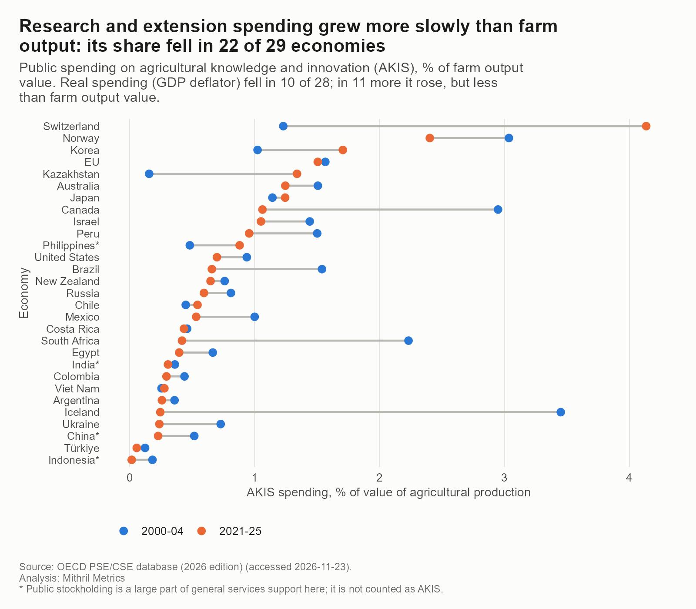
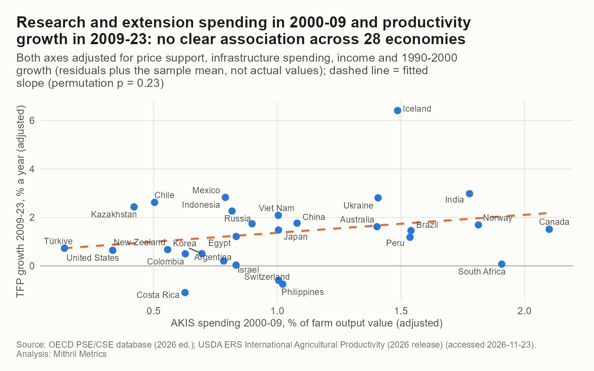

---
# ONE source file -> three outputs (07_report_and_post_templates.md):
#   (1) blog post            report.html   (format: html, sections A1-A8)
#   (2) LinkedIn post        output/linkedin_post.txt + output/linkedin_check.txt (section B)
#   (3) technical note, 2-3 pages A4, brief.pdf (format: typst, section C): the place for more detail
# Every number comes from output/key_numbers.csv through kn(); an unknown key stops the render.
title: "Farm research spending has not kept pace with farm output. What would catching up cost?"
description: "Public spending on agricultural research and extension fell as a share of farm output in most of 29 economies since 2000-04. Catching up would cost about USD 13 bn a year; higher spending in the 2000s shows no clear link with later productivity growth."
author: "Pietro Sala"
date: "2026-11-23"
categories: ["Region: Global", "Method: TFP", "Theme: Agricultural policy"]
image: output/fig1_hero.png           # listing thumbnail + open-graph image
draft: true                           # set to false to publish
title-block-banner: true
params:
  linkedin_max_chars: 1300
  linkedin_hook_max_chars: 210        # approx. text visible before "...see more" on mobile
  strict: false                       # true = stop the render if LinkedIn limits are exceeded
format:
  html:
    toc: false
    format-links: false
  typst:
    output-file: brief                # -> brief.pdf
    papersize: a4
    margin:
      x: 1.7cm
      y: 1.4cm
    fontsize: 11pt
    fig-format: png
    keep-typ: false
execute:
  echo: false
  warning: false
  message: false
---

```{r}
#| label: guard
#| include: false
# Before the analysis has been run there are no results: stop knitting here, so the
# website build on GitHub does not fail while a case is still in progress.
if (!file.exists("output/key_numbers.csv")) knitr::knit_exit("*Results pending.*")
```

```{r}
#| label: setup
#| include: false
suppressPackageStartupMessages({
  library(acutils)
  library(yaml)
})
meta    <- yaml::read_yaml("00_meta.yml", fileEncoding = "UTF-8")
kn_file <- "output/key_numbers.csv"
k <- function(key, ...) acutils::kn(key, file = kn_file, ...)   # formatted key number
kn_tbl  <- acutils::kn_read(kn_file)
`%||%` <- function(a, b) if (is.null(a) || identical(a, "")) b else a
bold_first <- function(x) unname(vapply(x, function(s) {   # PDF: bold the first sentence, or its lead clause if long
  sent <- sub("^(.+?[.:])( .*|)$", "\\1", s, perl = TRUE)
  lead <- sent
  if (length(strsplit(sent, " ")[[1]]) > 16) {
    cl <- sub("^(.+?[,;])( .*|)$", "\\1", s, perl = TRUE)
    if (cl != s) lead <- cl
  }
  paste0("**", lead, "**", substring(s, nchar(lead) + 1))
}, ""))
bullets  <- function(x) cat(paste0("- ", x), sep = "\n")
site_url <- "https://mithril-metrics.github.io"   # same for both authors
case_id  <- meta$id %||% basename(getwd())
blog_url <- meta$links$blog %||% paste0(site_url, "/cases/", case_id, "/report.html")
code_url <- meta$links$code %||% paste0("https://github.com/Mithril-Metrics/mithril-metrics.github.io/tree/main/cases/", case_id)
```

```{r}
#| label: shared-text
#| include: false
# ---------------------------------------------------------------------------------
# WRITE HERE ONCE. These strings feed the blog, the technical note (PDF) and the LinkedIn post.
# Every number comes from output/key_numbers.csv through k().
p2 <- function(key) k(key, digits_override = 2)
usd <- function(key) paste0("USD ", k(key), " bn")
question <- meta$question

bottom_line <- paste0(
  "**Public spending on agricultural research, extension and education has grown more slowly than ",
  "farm output: its share of output value fell in ", k("n_lower"), " of ", k("n_dumb"),
  " economies between 2000-04 and 2021-25**, although in real terms it fell in only ",
  k("n_real_fall"), " of ", k("n_real_avail"), ". Returning each economy to its 2000-04 share would cost about ",
  usd("gap_usd_bn"), " a year (", usd("gap_usd_bn_xchn"), " without China), a median of ",
  k("gap_pct_budget_median", unit = TRUE), " of what governments spend on budgetary support to agriculture. ",
  "Across ", k("n_ld"), " economies, higher spending in the 2000s shows **no clear association** with ",
  "productivity growth in 2009-23; the positive point estimate depends mainly on Iceland."
)

key_figures <- list(
  c(value = paste0(k("n_lower"), " of ", k("n_dumb")),
    label = "Economies where research and extension spending fell as a share of farm output value, 2000-04 to 2021-25"),
  c(value = usd("gap_usd_bn"),
    label = "Extra spending a year to return every economy to its 2000-04 share"),
  c(value = k("gap_pct_budget_median", unit = TRUE),
    label = "That extra spending as a share of each economy's budgetary support to agriculture (median)")
)

why_now <- paste0(
  "The OECD's Agricultural Policy Monitoring and Evaluation 2026, released on 2 November, finds that ",
  "government support to agriculture has risen to a record level while spending on general services, ",
  "which includes research, extension and infrastructure, has fallen relative to the size of the sector, ",
  "and agricultural productivity growth has slowed. It recommends shifting support toward knowledge and ",
  "innovation. We ask three questions with the OECD's own data: has public spending on agricultural ",
  "knowledge and innovation kept pace with farm output, what would catching up cost, and did economies ",
  "that spent more in the 2000s see faster productivity growth afterwards?"
)

method_plain <- paste0(
  "We take public spending on the agricultural knowledge and innovation system (AKIS: research, ",
  "extension and education) from the OECD support database for ", k("n_dumb"), " economies, the EU counted ",
  "as one, and express it as a share of the value of farm output. We compare 2000-04 with 2021-25 and cost ",
  "the gap. We then compare economies: spending in 2000-09 against growth in total factor productivity ",
  "(TFP, output per unit of all inputs, from USDA) in 2009-23, holding price support, infrastructure ",
  "spending, income and past growth fixed. With ", k("n_ld"), " economies, we test the result by reshuffling ",
  "the data ", "9,999 times rather than relying on textbook formulas."
)

findings <- c(
  paste0("Real spending fell in only ", k("n_real_fall"), " of ", k("n_real_avail"),
         "; mostly it grew, but more slowly than output"),
  paste0("The catch-up cost is a median ", k("gap_pct_budget_median", unit = TRUE), " of budgetary support, ",
         "but more than the whole general services budget in Brazil and South Africa"),
  paste0("No clear link between spending in the 2000s and productivity growth in 2009-23 (",
         k("n_ld"), " economies)")
)
li_meaning <- paste0("If the aim is to keep research in step with the sector, the cost is small next to budgetary ",
                     "support in most economies and large where general services budgets are thin. These data ",
                     "cannot show the productivity payoff.")

implications <- c(
  paste0("If the aim is to keep public research and extension in step with the sector, returning each ",
         "economy to its 2000-04 share would take about ", usd("gap_usd_bn"), " a year (", usd("gap_usd_bn_xchn"),
         " without China), a median ", k("gap_pct_gsse_median", unit = TRUE), " of current general services ",
         "spending. In ", k("n_gap_gsse_over100"), " economies (Brazil, South Africa and Iceland) it would exceed ",
         "their whole general services budget; research and extension systems cannot absorb that quickly, so ",
         "the trade-off is speed against how well the money is spent."),
  paste0("If the aim is to fund it by moving away from market price support, as the OECD recommends, the gap ",
         "is a median ", k("gap_pct_mps_median", unit = TRUE), " of each economy's price support, but half or ",
         "more in ", k("n_gap_mps_half"), " economies (Brazil, Canada and South Africa). Price support is paid ",
         "mostly by consumers through higher prices and research by taxpayers, so a shift moves the cost from ",
         "one group to the other rather than freeing an existing budget line."),
  paste0("If the aim is to justify more spending by faster productivity growth, these cross-country data ",
         "neither confirm nor rule out such gains over 15 years. The case rests on longer series and country ",
         "studies of returns to research, which this comparison does not replace.")
)

caveats <- c(
  paste0("**Ratios move with farm output value.** The share fell mainly because output value grew faster ",
         "than spending, partly with the 2022-23 price spike; real spending fell in only ", k("n_real_fall"),
         " of ", k("n_real_avail"), " economies."),
  paste0("**No evidence of an effect, but no evidence against one either.** The 95% range (",
         p2("beta1_ld_lo95"), " to ", p2("beta1_ld_hi95"), " points of growth per point of spending) fits zero ",
         "and very large returns alike. Theory links productivity to accumulated research, and a high spending ",
         "share in 2000-09 can also reflect a weak farm sector that later recovered."),
  paste0("**One economy drives the estimate.** Iceland's measured productivity growth is far above every ",
         "other economy's; without it the coefficient falls from ", p2("beta1_ld"), " to ", p2("beta1_no_isl"), "."),
  paste0("**Some series change level abruptly.** Iceland (2007), Switzerland (2006) and Kazakhstan (2014) ",
         "show step changes in the research share of general services that OECD notes do not explain; for ",
         "Switzerland the OECD reports a large real increase. Among the ", k("n_dumb_nostep"), " economies ",
         "whose series show no jump at all, the share still fell in ", k("n_lower_nostep"), "."),
  paste0("**The cost is a yardstick, not a target.** It scales with today's farm output value, which was ",
         "unusually high in 2022-23, and it adds up national gaps that are decided country by country.")
)

why_short <- paste0("The OECD's 2026 monitoring report (2 November) recommends shifting farm support toward ",
                    "knowledge and innovation. We checked what its own data show.")

method_tag <- paste0("Method: OECD support data and USDA TFP, ", k("n_dumb"), " economies, 2000-2025; ",
                     "cross-country comparison with permutation inference")
hashtags <- "#AgriculturalPolicy #Innovation #Productivity #OECD"

# ---- Technical note (PDF) only ----
method_detail <- paste0(
  "**We measure public AKIS spending relative to farm output, cost the gap to 2000-04 levels, and relate ",
  "spending in 2000-09 to TFP growth in 2009-23.** *Data.* OECD PSE/CSE database, 2026 edition: GSSE and ",
  "its AKIS share (DF_GSSE, DF_COMGSSE), market price support and value of production (DF_COMM, all ",
  "commodities), total support (DF_TSE); USDA ERS International Agricultural Productivity, 1961-2023; ",
  "WDI GDP per capita (PPP) and GDP deflators. Ratios are sums over each window in USD. *Model.* TFP growth ",
  "(OLS slope of log TFP, 2009-23) on AKIS, price support and infrastructure spending (each % of value of ",
  "production, 2000-09), log GDP per capita 2000-04 and TFP growth 1990-2000; one row per economy, EU and ",
  "UK excluded (n = ", k("n_ld"), "). *Inference.* HC3 standard errors; Freedman-Lane permutation test, 9,999 ",
  "draws; one primary coefficient. *Identification.* None for a causal effect: a cross-country association."
)
results_note <- c(
  paste0("**Spending grew more slowly than output.** Median AKIS share ", k("akis_median_base", unit = TRUE),
         " of output value in 2000-04, ", k("akis_median_now", unit = TRUE), " in 2021-25; lower in ",
         k("n_lower"), " of ", k("n_dumb"), " economies. Real spending (GDP deflator) fell in ", k("n_real_fall"),
         " of ", k("n_real_avail"), " and rose more slowly than output value in ", k("n_real_rise_ratio_fall"), "."),
  paste0("**Catching up would cost about ", usd("gap_usd_bn"), " a year** (China ", usd("gap_usd_bn_chn"),
         "); a median ", k("gap_pct_budget_median", unit = TRUE), " of budgetary support (total support minus ",
         "market price support), ", k("gap_pct_gsse_median", unit = TRUE), " of general services and ",
         k("gap_pct_mps_median", unit = TRUE), " of price support. AKIS spending in 2023-25: ",
         usd("akis_usd_bn_now"), " a year."),
  paste0("**No clear association with later productivity growth.** Coefficient ", p2("beta1_ld"),
         " points of annual TFP growth per point of AKIS share (95% interval ", p2("beta1_ld_lo95"), " to ",
         p2("beta1_ld_hi95"), "; permutation p = ", p2("p_perm_ld"), "); ", p2("effect_sd_ld"),
         " points per standard deviation of spending (", p2("sd_akis_ld"), "), against median growth of ",
         k("g_post_median", unit = TRUE), " a year.")
)
robustness <- c(
  paste0("**Leaving out one economy at a time** moves the coefficient between ", p2("beta1_loo_min"), " (without ",
         "Iceland) and ", p2("beta1_loo_max"), "; without the four economies where public stockholding dominates ",
         "general services, ", p2("beta1_r2"), "."),
  paste0("**A within-country check with a five-year lag is uninformative.** Coefficient ", p2("beta1_fe"),
         " (CR2 p = ", p2("p_fe_cr2"), ", wild cluster bootstrap p = ", p2("p_fe_wb"), "); three economies ",
         "with step changes hold most of its variation, and without them the sign flips (", p2("beta1_fe_diag"), ")."),
  paste0("**Step changes do not drive the spending decline.** In the ", k("n_dumb_nostep"), " economies with no ",
         "one-year jump above 50% in the AKIS share of general services, the share fell in ", k("n_lower_nostep"),
         ". Canada's 2000-04 base without its 2003 spike lowers its gap from ", k("can_gap_pct_mps", unit = TRUE),
         " to ", k("can_gap_pct_mps_x03", unit = TRUE), " of its price support."),
  paste0("**Benchmarks match the OECD report.** General services ", k("bench_gsse_pct_vp", unit = TRUE),
         " of output value in 2023-25 (APME 2026: 2.4%); AKIS ", k("bench_akis_pct_vp", unit = TRUE),
         " in 2022-24 (APME 2025: about 0.5%).")
)
references <- c(
  "OECD (2026). *Agricultural Policy Monitoring and Evaluation 2026*. OECD Publishing. [Link](https://www.oecd.org/en/publications/agricultural-policy-monitoring-and-evaluation-2026_2c7f3be1-en.html)",
  "Fuglie, K. (2018). R&D capital, R&D spillovers, and productivity growth in world agriculture. *Applied Economic Perspectives and Policy*, 40(3), 421-444. [doi](https://doi.org/10.1093/aepp/ppx045)",
  "Baldos, U. L. C., Viens, F. G., Hertel, T. W., & Fuglie, K. O. (2019). R&D spending, knowledge capital, and agricultural productivity growth: A Bayesian approach. *American Journal of Agricultural Economics*, 101(1), 291-310.",
  "Alston, J. M., Chan-Kang, C., Marra, M. C., Pardey, P. G., & Wyatt, T. J. (2000). *A meta-analysis of rates of return to agricultural R&D*. IFPRI Research Report 113. [Link](https://ageconsearch.umn.edu/record/16535)"
)
author_slug <- gsub("[^a-z]+", "-", tolower(iconv(rmarkdown::metadata$author %||% "", to = "ASCII//TRANSLIT")))
```

::: {.content-visible when-format="html"}

::: {.bottom-line}
**Short answer.** `r bottom_line`
:::

```{r}
#| label: key-figures
#| results: asis
cat('<div class="key-figures">\n')
for (f in key_figures) {
  cat('<div class="kf"><div class="kf-value">', f[["value"]], '</div><div class="kf-label">',
      f[["label"]], '</div></div>\n', sep = "")
}
cat('</div>\n')
```

## Why this matters now

`r why_now` [Primary source](`r meta$hook$primary_source$url %||% "#"`).

## What we did

::: {.method-note}
`r method_plain`
:::

## What the data show

### Spending has grown more slowly than farm output

{fig-alt="Dot chart of 29 economies comparing public research, extension and education spending as a share of farm output value in 2000-04 and 2021-25; the share is lower in 22 economies and higher in 7." width="100%"}

**The share of farm output value that governments spend on research, extension and education fell in `r k("n_lower")` of `r k("n_dumb")` economies**, from a median of `r k("akis_median_base", unit = TRUE)` in 2000-04 to `r k("akis_median_now", unit = TRUE)` in 2021-25. This is mostly slower growth, not cuts: in real terms spending fell in `r k("n_real_fall")` of `r k("n_real_avail")` economies and rose more slowly than output value in `r k("n_real_rise_ratio_fall")` more. Some national series change level abruptly, but among the `r k("n_dumb_nostep")` economies whose series show no jump, the share still fell in `r k("n_lower_nostep")`. Our total for general services, `r k("bench_gsse_pct_vp", unit = TRUE)` of output value in 2023-25, matches the OECD's figure.

### Catching up would cost about `r usd("gap_usd_bn")` a year

**Returning each economy to its own 2000-04 share would take about `r usd("gap_usd_bn")` a year**, on top of the `r usd("akis_usd_bn_now")` spent in 2023-25. China accounts for `r usd("gap_usd_bn_chn")` of it. Measured against what each government already spends, the gap is a median `r k("gap_pct_budget_median", unit = TRUE)` of budgetary support to agriculture and `r k("gap_pct_gsse_median", unit = TRUE)` of general services. Against market price support it is a median `r k("gap_pct_mps_median", unit = TRUE)`, but half or more in Brazil, Canada and South Africa. Canada's figure depends partly on a one-year spike in 2003; without it, the gap falls from `r k("can_gap_pct_mps", unit = TRUE)` to `r k("can_gap_pct_mps_x03", unit = TRUE)` of its price support.

### No clear link with later productivity growth

{fig-alt="Scatter of 28 economies: adjusted research and extension spending in 2000-09 against adjusted productivity growth in 2009-23, with a gently rising fitted line; Iceland lies far above all others." width="100%"}

**Economies that spent more on research and extension in 2000-09 did not show clearly faster productivity growth in 2009-23.** The estimate is positive, `r p2("effect_sd_ld")` points of annual growth for one standard deviation more spending, but the 95% range runs from `r p2("beta1_ld_lo95")` to `r p2("beta1_ld_hi95")` points per point of spending (p = `r p2("p_perm_ld")`). It depends mainly on Iceland, whose measured productivity growth is far above every other economy's; without Iceland the coefficient falls from `r p2("beta1_ld")` to `r p2("beta1_no_isl")`. Returns to research build up over decades, so 15 years of cross-country data are a weak test either way.

## What this means for policy

```{r}
#| results: asis
bullets(implications)
```

::: {.caveats}
## Caveats

```{r}
#| results: asis
bullets(caveats)
```
:::

::: {.data-code}
## Data & code

```{r}
#| results: asis
src <- Filter(function(s) !is.null(s$name), meta$sources)
if (length(src)) {
  bullets(vapply(src, function(s) paste0(
    "**", s$name, "**", if (!is.null(s$table)) paste0(" (", s$table, ")") else "",
    if (!is.null(s$version)) paste0(", version ", s$version) else "",
    if (!is.null(s$accessed)) paste0(", accessed ", s$accessed) else "",
    if (!is.null(s$url)) paste0(". [Link](", s$url, ")") else ""), ""))
} else {
  cat("- *Fill `sources` in 00_meta.yml.*\n")
}
cat("\nCode to reproduce every number and figure: [GitHub](", code_url, "). ",
    "Technical note with more detail (PDF, 2-3 pages): [brief.pdf](brief.pdf).\n", sep = "")
```

**Use of AI tools.** We use Claude, an AI assistant by Anthropic, as a working tool: to help with coding, data retrieval scripts and first drafts of text. Questions, methods, robustness checks and conclusions are our own, every number is reproducible from the published code, and we review all text before it goes online.
:::

```{r}
#| label: post-footer
#| results: asis
photo <- file.path("..", "..", "images", "people", paste0(author_slug, ".jpg"))
cat('<div class="post-footer">',
    if (nzchar(author_slug)) paste0('') else "",
    '<p>Written by <a href="../../people/', author_slug, '.html">', rmarkdown::metadata$author,
    '</a>. Views are the authors\' own. Part of <em>Mithril Metrics</em>: short, reproducible analyses ',
    'of current agri-food, water and climate policy questions.</p></div>\n', sep = "")
```

:::

::: {.content-visible when-format="typst"}

<!-- TECHNICAL NOTE (2-3 pages A4, never more). The blog and LinkedIn stay concise; extra
     detail goes here: specification, identification, inference, results and robustness as short
     bullets with a bolded lead (no tables), references and data sources one per line. Same style rules: concise, every
     result from kn(), untested mechanisms labelled, one bolded key sentence per section. -->

**Question.** `r question`

**Short answer.** `r bottom_line`

**1. Data and method**

`r method_detail`

**2. Results**

{width="70%"}

{width="70%"}

```{r}
#| results: asis
bullets(results_note)
```

**3. Robustness checks**

```{r}
#| results: asis
bullets(robustness)
```

**4. What this means for policy**

```{r}
#| results: asis
bullets(bold_first(implications))
```

**5. Caveats**

```{r}
#| results: asis
bullets(caveats)   # caveats already carry their own bold lead
```

**References**

```{r}
#| results: asis
bullets(references)
```

```{r}
#| label: brief-sources
#| include: false
src_brief <- vapply(Filter(function(s) !is.null(s$name), meta$sources), function(s)
  paste0(s$name, if (!is.null(s$accessed)) paste0(" (accessed ", s$accessed, ")") else ""), "")
if (!length(src_brief)) src_brief <- "[fill sources in 00_meta.yml]"
```

**Data and code**

```{r}
#| results: asis
bullets(c(src_brief, paste0("Code: [GitHub, Mithril-Metrics](", code_url, ")")))
```

```{=typst}
#text(size: 9pt, fill: rgb("#5b6876"))[`r rmarkdown::metadata$author` · Views are the authors' own. Mithril Metrics · mithril-metrics.github.io]
```

```{=typst}
#text(size: 8pt, fill: rgb("#5b6876"))[*Use of AI tools.* We use Claude, an AI assistant by Anthropic, as a working tool: to help with coding, data retrieval scripts and first drafts of text. Questions, methods, robustness checks and conclusions are our own, every number is reproducible from the published code, and we review all text before it goes online.]
```

:::

```{r}
#| label: linkedin
#| include: false
# Section B: LinkedIn post, built from the same strings and key numbers.
hook <- paste0("Public spending on farm research and extension fell as a share of farm output in ", k("n_lower"), " of ", k("n_dumb"), " economies since 2000-04. Catching up would cost about ", usd("gap_usd_bn"), " a year.")
li <- paste0(
  hook, "\n\n",
  why_short, "\n\n",
  "What we found:\n", paste0("→ ", findings, collapse = "\n"), "\n\n",
  "What it means: ", li_meaning, "\n\n",
  method_tag, "\n",
  "Full analysis and code: link in the first comment\n\n",
  hashtags
)
dir.create("output", showWarnings = FALSE)
writeLines(li, "output/linkedin_post.txt", useBytes = TRUE)
writeLines(paste0("Full analysis and code: ", blog_url), "output/linkedin_first_comment.txt", useBytes = TRUE)

n_total <- nchar(li, type = "chars")
n_hook  <- nchar(hook, type = "chars")
checks <- c(
  sprintf("LinkedIn post: %d characters (limit %d) %s", n_total, params$linkedin_max_chars,
          if (n_total <= params$linkedin_max_chars) "OK" else "TOO LONG"),
  sprintf("Hook: %d characters (aim <= %d, approx. visible before 'see more') %s", n_hook,
          params$linkedin_hook_max_chars,
          if (n_hook <= params$linkedin_hook_max_chars) "OK" else "TOO LONG"),
  sprintf("Placeholders left: %s", if (grepl("\\[|Placeholder", li)) "YES - edit before posting" else "none")
)
writeLines(checks, "output/linkedin_check.txt")
message(paste(checks, collapse = "\n"))
too_long <- n_total > params$linkedin_max_chars || n_hook > params$linkedin_hook_max_chars
if (too_long && isTRUE(params$strict)) stop(paste(checks, collapse = "\n"))
if (too_long) warning(paste(checks, collapse = "\n"))
```
